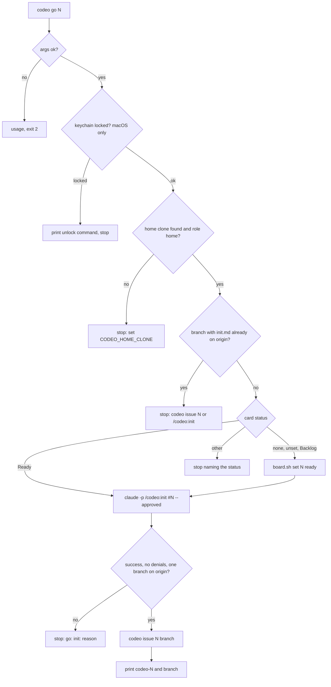

# `codeo go`, `codeo done`, `--version` and a verbose `codeo update` Implementation Plan

> **For agentic workers:** REQUIRED SUB-SKILL: Use superpowers:subagent-driven-development (recommended) or superpowers:executing-plans to implement this plan task-by-task. Steps use checkbox (`- [ ]`) syntax for tracking.

**Goal:** Start an issue with `codeo go <N>` and finish it with `codeo done <N>`, give the `codeo` host command a version of its own, and make `codeo update` say what it does.

**Architecture:** Everything the host command adds lives in `.devcontainer/codeo` (and the same text in its template). `go` and `done` run in the engineer's home clone: `go` moves the card, runs `claude -p "/codeo:init #<N> --approved"` there, checks that the branch reached `origin`, then runs the existing `codeo issue`; `done` asks a new `cleanup.sh prove <N>` for the five proofs and only then calls the existing `cmd_rm`, then records the removal. Both first run a macOS keychain preflight. Two plugin files change to support them: `scripts/cleanup.sh` (the `prove` mode) and `skills/init/SKILL.md` (the `--approved` form).

**Tech Stack:** bash (4.3+ on the host), `jq`, `gh`, `claude -p`, the shell test files under `tests/`.

**Spec:** `.codeo/217/issue.md` and the answers in `.codeo/217/plan.md` (Q1–Q7). No separate reference doc: the decisions are the ones below.

## Global Constraints

- **Invariants:** the project configures none (`.invariants` is unset), so there is nothing to check this plan against.
- **No shared environment:** `.environment.resource` is unset; no task carries `Needs lease:`. The lock's `host` is `container`, so a task the engineer runs on their own machine says `Runs on: the engineer's host` (Task 9 only, optional).
- **Proofs:** the `shell` suite has no single-test filter, so a task's proof is the test file it writes or extends, run with `bash` (every file ends `all cases passed`); Tasks 1, 7 and 9 also run the whole suite, `bash tests/run.sh`.
- **One command, two copies:** `templates/containers/.devcontainer/codeo` is `.devcontainer/codeo` with `@CODENAME@`, `@REPO_SLUG@` and `@BASE_BRANCH@` in place of `codeo`, `kbajpai/codeo` and `main`. Every edit to `.devcontainer/codeo` is made identically in the template, in the same task. `bash tests/containers.test.sh` renders the template and must still pass.
- **Bash 4.3**, as the file already needs; no new tools beyond `jq` and `claude`, which the home checkout already requires (`docs/home-checkout.md`).
- **Every failure is one line:** `codeo: <message>` on stderr via `die`; `go` names its step (`codeo: go: <step>: <reason>`), `done` names the failed proof. Argument errors print usage, exit 2 and make no call, as every command does today.
- **Order of checks in `go` and `done`:** arguments, then the keychain preflight, then everything else. A refused argument or a locked keychain makes no `git`, `gh`, `docker`, `claude` or `curl` call.
- **Existing behaviour stays:** `cmd_update`'s atomic replace and every failure message, `cmd_rm`'s safety check, `codeo issue`'s lookup. `done` never passes `--force`; it is the only command that removes a container by itself.
- **Version:** `CODEO_VERSION` equals `.claude-plugin/plugin.json`'s `version` at the time this ships. The release checklist moves it with the plugin version (Task 9); a test compares them.
- **Footprint against other workflows:** #207 and #213 share `README.md`, `docs/release-checklist.md`, `CHANGELOG.md` and the skills inventory files (Q7: proceed and coordinate). Start each round with `git merge origin/main`; whichever of #207 and this branch merges second regenerates `tests/fixtures/skills-inventory.rules.sha256` (`bash tests/inventory.test.sh --update`) and moves its changelog entry to the form `main` then has.
- **Documentation:** this change moves `README.md` (host command section and keychain pointer), `.devcontainer/README.md` (command list, `update`, the keychain section, a flow diagram), `docs/home-checkout.md` (the keychain sentence), `docs/release-checklist.md` (step 6) and `CHANGELOG.md`; Task 9 owns them.

## Review Focus

- `codeo go` on an issue whose card is In progress, In review or Done: stops at the board step with the status named, and calls neither `claude` nor docker.
- The headless run exits 0 but pushed no branch (the model asked a question as text, or `/codeo:init` was not recognised as a command and went to the model as plain text): `go` fails at `init` and never reaches `codeo issue`.
- `--version` run from a symlinked or renamed copy of the command prints the constant, not a file lookup.
- `codeo done` on an issue with no container (already removed): the proofs pass, `cmd_rm` says there is nothing to remove, and no removal record is written.
- `codeo update` where the downloaded `codeo` predates `CODEO_VERSION` (no such line): prints the new version as `unknown`, still installs, and exits 0.

## File Structure

| File | Change |
|---|---|
| `.devcontainer/codeo`, `templates/containers/.devcontainer/codeo` | `CODEO_VERSION`; `--version`/`-v`; verbose `cmd_update`; `keychain_check`; `home_clone`, `plugin_root`; `cmd_done`; `cmd_go`; usage, help and dispatch |
| `scripts/cleanup.sh` | a `prove <N>` mode |
| `skills/init/SKILL.md` | the `--approved` form; rule init-12 |
| `tests/codeo-command.test.sh` | new cases for all of the above; `jq`, `claude`, `security` and `uname` stubs |
| `tests/cleanup.test.sh`, `tests/init-skill.test.sh`, `tests/readme.test.sh` | new cases |
| `docs/skills-inventory.md`, `docs/skills.md`, `tests/fixtures/skills-inventory.rules.sha256` | init-12 |
| `README.md`, `.devcontainer/README.md`, `docs/home-checkout.md`, `docs/release-checklist.md`, `CHANGELOG.md` | Task 9 |

---

### Task 1: `CODEO_VERSION`, `--version` and `-v`

**Files:**
- Modify: `.devcontainer/codeo`, `templates/containers/.devcontainer/codeo`
- Test: `tests/codeo-command.test.sh`

**Interfaces:**
- Produces: the constant `CODEO_VERSION=1.0.11` (first assignment after `set -euo pipefail`, one line, no quotes), read by Task 2 from a downloaded copy with `sed -n 's/^CODEO_VERSION=//p'`.
- Produces: `cmd_version`, printing `codeo <version>` on stdout, exit 0.

- [ ] **Step 1: Write the failing tests** in `tests/codeo-command.test.sh`, listed in `cases=(…)`:
  - `t_version_flags_print_the_constant`: `cm_run --version` and `cm_run -v` both give status 0, stdout `codeo 1.0.11`, empty stderr, and `calls` is empty.
  - `t_version_equals_plugin_json`: `jq -r .version .claude-plugin/plugin.json` equals the value of `CODEO_VERSION=` in both `.devcontainer/codeo` and the template; the failure message names the file that differs.
  - `t_version_extra_args_usage`: `cm_run --version x` is a usage error (exit 2, no call).
  - Extend `t_usage_and_help_list_yes`'s sibling: `cm_run help` and the usage text list `--version`.
- [ ] **Step 2: Run** `bash tests/codeo-command.test.sh`. Expected: FAIL on the four cases above.
- [ ] **Step 3: Implement** `CODEO_VERSION` and `cmd_version` in both files; dispatch `--version | -v` in `main`'s `case` before `*)`; add the line `  --version, -v    print the codeo version` to `usage` and `cmd_help`. `cmd_version` takes no argument (`[[ $# -eq 0 ]] || usage`).
- [ ] **Step 4: Run** `bash tests/codeo-command.test.sh && bash tests/containers.test.sh`. Expected: both end `all cases passed`.
- [ ] **Step 5: Commit** `feat: add --version to the codeo command (#217)`.

**Proof of done:** `bash tests/codeo-command.test.sh` ends `all cases passed`.

### Task 2: A verbose `codeo update`

**Files:**
- Modify: both `codeo` files (`cmd_update`)
- Test: `tests/codeo-command.test.sh`

**Interfaces:**
- Consumes: `CODEO_VERSION` and the `sed` read from Task 1.
- Produces: stdout lines, in order: `version: <old> -> <new>` (or `version: <old> (already the newest)` when equal); `downloading <name>` and `downloaded <name>` for each of the four files; `installing <name>` and `installed <name>` for each of the four; and last, unchanged, `updated codeo and its three scripts`. Failure messages and the `nothing changed` / `part-way` wording are untouched.

- [ ] **Step 1: Write the failing tests:**
  - `t_update_prints_versions_and_each_file`: with a stub download whose `codeo` carries `CODEO_VERSION=9.9.9`, stdout lines equal the sequence above, in that order, and the last line is exactly `updated codeo and its three scripts`.
  - `t_update_same_version_says_so`: a download with the installed version prints `(already the newest)` and still installs.
  - `t_update_old_download_says_unknown`: a download with no `CODEO_VERSION=` line prints `version: <old> -> unknown`, exits 0.
  - Update `t_update_replaces_three`, which asserts stdout is the single line, to assert the last line instead. The existing failure cases (`t_update_failed_download_changes_nothing`, `…_empty_file_refused`, `…_not_a_script_refused`, `…_partial_*`) are left as they are and must keep passing; add to each a check that stdout has no `installed` line before the failure it provokes.
- [ ] **Step 2: Run** `bash tests/codeo-command.test.sh`. Expected: FAIL on the three new cases and `t_update_replaces_three`.
- [ ] **Step 3: Implement.** Print `downloading`/`downloaded` around each `curl` in the existing loop, read the new version from `$upd_tmp/codeo` after the loop, print the `version:` line before the first `mv`, and `installing`/`installed` around each `mv -f`. No change to what is moved or in which order.
- [ ] **Step 4: Run** `bash tests/codeo-command.test.sh && bash tests/containers.test.sh`. Expected: `all cases passed` twice.
- [ ] **Step 5: Commit** `feat: codeo update prints versions and each file (#217)`.

**Proof of done:** `bash tests/codeo-command.test.sh` ends `all cases passed`.

### Task 3: The keychain preflight and the home clone lookup

**Files:**
- Modify: both `codeo` files
- Test: `tests/codeo-command.test.sh`

**Interfaces:**
- Produces: `keychain_check` (no arguments): on `uname -s` = `Darwin`, runs `security show-keychain-info "$HOME/Library/Keychains/login.keychain-db"`; a non-zero exit is a locked keychain and ends with `die "the login keychain is locked, and claude and docker read it; unlock it, then run this again: security -v unlock-keychain ~/Library/Keychains/login.keychain-db"`; a missing `security` on Darwin, or any other OS, returns 0. The `security` call is the only call it makes.
- Produces: `home_clone` — prints the absolute path of the home clone: `$CODEO_HOME_CLONE` when set, else `$PWD`; dies `codeo: <path> is not a codeo home checkout (its role is <role>); run this in your <codename>-home clone or set CODEO_HOME_CLONE` unless `bash <path>/.devcontainer/scripts/role.sh <path>` prints `home`.
- Produces: `plugin_root <clone>` — prints `bash <clone>/.devcontainer/scripts/codeo-root.sh`'s output (run with the clone as cwd), or dies with its one `codeo-root:` line prefixed by `codeo: `.
- `abs_path_env CODEO_HOME_CLONE always` joins `main`'s list.

- [ ] **Step 1: Write the failing tests** (they reach the functions through `go` and `done`, so they land with Task 5 and 7's dispatch; here they are written against the `done` stub below, which Task 3 adds as a `cmd_done`/`cmd_go` that only validate arguments and call the two checks, so these cases pass now and the later tasks extend them):
  - `t_keychain_locked_stops_before_any_call`: stub `uname` printing `Darwin`, stub `security` exiting 36; `cm_run done 5` exits 1, stderr is exactly the line above, and `calls` holds only the `security` line.
  - `t_keychain_unlocked_goes_on`: `security` exits 0; the keychain line is absent and `home_clone`'s message appears (the run reaches the next check).
  - `t_keychain_skipped_off_macos`: `uname` prints `Linux`, no `security` call is logged.
  - `t_home_clone_refuses_a_non_home_checkout`: `role.sh` stub prints `stray`; the die line names `stray`.
  - `t_home_clone_env_wins_over_cwd`.
  - `t_bad_arguments_are_usage_before_the_keychain`: `cm_run go x`, `cm_run done`, `cm_run go 5 --force` each exit 2 with no `security` call.
- [ ] **Step 2: Run** `bash tests/codeo-command.test.sh`. Expected: FAIL (`go` and `done` are unknown commands, usage exit 2).
- [ ] **Step 3: Implement** the three functions and skeletal `cmd_go`/`cmd_done` (argument parse: `<N>` valid_number, `--container|--sandbox` through `parse_kind_flag`, `--yes` for `go` only; then `keychain_check`; then `home_clone`; then `die "not implemented"`), add both to usage, help and `main`. Add `jq`, `claude` and `security` to the stub set in `cm_setup` and `jq` to `cm_sys`'s tool list.
- [ ] **Step 4: Run** `bash tests/codeo-command.test.sh && bash tests/containers.test.sh`. Expected: `all cases passed` twice.
- [ ] **Step 5: Commit** `feat: keychain preflight and home clone lookup for codeo go and done (#217)`.

**Proof of done:** `bash tests/codeo-command.test.sh` ends `all cases passed`.

### Task 4: `cleanup.sh prove <N>`

**Files:**
- Modify: `scripts/cleanup.sh` (header comment and a new mode beside `record`)
- Test: `tests/cleanup.test.sh`

**Interfaces:**
- Produces: `cleanup.sh prove <N>` prints one line, `<N><TAB>proven` or `<N><TAB>failed<TAB><proof>` (`issue`, `pull-request`, `branch`, `dossier` or `lease`), and exits 0 for both; any error is exit 1 with a `cleanup:` line. It runs the same `first_failed_proof` as the list, reads the overlay and the removal records not at all, and never prints a command. An issue with no `.codeo/done/<N>` on the base branch fails `pull-request`.

- [ ] **Step 1: Write the failing tests** in `tests/cleanup.test.sh`, in its existing style:
  - `prove_prints_proven_when_every_proof_passes`
  - `prove_names_each_failing_proof` (loops the five existing fixtures: issue open, PR unmerged, branch still on origin, dossier still on a branch, lease held; expects the proof name each time)
  - `prove_ignores_a_removal_record_and_the_overlay` (the issue is recorded as removed and the overlay is absent; still `proven`)
  - `prove_needs_one_issue_number`: `prove`, `prove x` and `prove 1 2` exit 1 with a `cleanup:` usage line.
- [ ] **Step 2: Run** `bash tests/cleanup.test.sh`. Expected: FAIL (`cleanup: usage: cleanup.sh [record <issue>…]`).
- [ ] **Step 3: Implement.** Accept `prove` in the argument parse; after the `leases=` read and before the overlay block, `first_failed_proof` is defined late in the file, so move its definition above the new mode (a pure move) and add the mode, which prints and `exit 0`. Add the mode to the header comment.
- [ ] **Step 4: Run** `bash tests/cleanup.test.sh`. Expected: `all cases passed`.
- [ ] **Step 5: Commit** `feat: cleanup.sh prove for one issue (#217)`.

**Proof of done:** `bash tests/cleanup.test.sh` ends `all cases passed`.

### Task 5: `codeo done <N>`

**Files:**
- Modify: both `codeo` files (`cmd_done`)
- Test: `tests/codeo-command.test.sh`

**Interfaces:**
- Consumes: `keychain_check`, `home_clone`, `plugin_root` (Task 3), `cleanup.sh prove`, `cleanup.sh record` and `intake.sh commit` (plugin scripts), `cmd_rm` (existing).
- Produces: `cmd_done`. Steps, each a stop on failure: keychain; home clone; `git -C <clone> fetch`; `prove` (`failed <proof>` ends with `codeo: done: #<N> is not finished: <proof> failed; nothing removed`, exit 1); `cmd_rm <N> [kind flag]` (no `--force`; its refusals and exits are `rm`'s own); then, only when `cmd_rm` returned 0, `cleanup.sh record <N>` and `intake.sh commit cleanup "docs(codeo): cleanup removal recorded for #<N>"` run in the clone, whose failure prints `codeo: warning: #<N> was removed but the removal was not recorded: <first line>` and does not change the exit. When the container was not found (`cmd_rm`'s `no container … found` die), nothing is recorded.

- [ ] **Step 1: Write the failing tests** (stubs: a `git` that logs, `claude` and `gh` that must not be called, `jq` real, a `codeo-root.sh` and `cleanup.sh` pair in a stub plugin root reached through `CODEO_ROOT`, programmed per case):
  - `t_done_removes_when_every_proof_passes`: `prove` prints `proven`; the docker calls are `rm`'s (`docker rm -f codeo-5`, `docker volume rm codeo-5`); `record` then `intake.sh commit` were called, in that order, in the clone; stdout holds `removed codeo-5`.
  - `t_done_names_the_failed_proof_and_removes_nothing`: for each of `issue pull-request branch dossier lease`, stderr is the one line above, exit 1, and `calls` holds no `docker` line.
  - `t_done_unsaved_work_still_refuses`: `rm`'s check finds an unpushed commit; the exit is non-zero, the line is `rm`'s, and nothing is recorded.
  - `t_done_record_failure_warns_and_exits_zero`.
  - `t_done_passes_the_kind_flag_to_rm`: `done 5 --sandbox` runs `codeo-sandbox.sh end 5`.
  - `t_done_never_passes_force`: `done 5 --force` is usage, exit 2.
- [ ] **Step 2: Run** `bash tests/codeo-command.test.sh`. Expected: FAIL (`done` dies `not implemented`).
- [ ] **Step 3: Implement** `cmd_done` as above. `cmd_rm` is called in the same shell with its argument array; the clone work runs in `( cd "$clone" && … )` so `cmd_rm`'s own `cd` is not disturbed.
- [ ] **Step 4: Run** `bash tests/codeo-command.test.sh && bash tests/containers.test.sh`. Expected: `all cases passed` twice.
- [ ] **Step 5: Commit** `feat: codeo done removes a finished issue's container (#217)`.

**Proof of done:** `bash tests/codeo-command.test.sh` ends `all cases passed`.

### Task 6: `/codeo:init #<N> --approved`

**Files:**
- Modify: `skills/init/SKILL.md`, `docs/skills-inventory.md`, `docs/skills.md`
- Modify (generated): `tests/fixtures/skills-inventory.rules.sha256`
- Test: `tests/init-skill.test.sh`

**Interfaces:**
- Produces, for `codeo go`: the argument `#<N> --approved` (or `<N> --approved`). `--approved` is a flag in `$ARGUMENTS`, not a number; step 2 resolves the number from the rest. With it, step 8 does not wait: it records one line under `## Notes` in `init.md`, `- <date> — approved in advance by the engineer through codeo go (--approved)`, and goes on. A question in the file, a closed issue, another assignee, a workflow already under way, a resume that needs the engineer's words, or any failed script still stops the skill, and the skill says so in its last message because nobody can answer in a headless run. `argument-hint` gains `[--approved]`.
- Produces: rule `init-12` in the skill, as a `<!-- rule: init-12 -->` comment, and its line in `docs/skills-inventory.md`.

- [ ] **Step 1: Write the failing tests** in `tests/init-skill.test.sh`, in its grep style: the skill names `--approved` in its `argument-hint`, step 0 and step 8; carries `<!-- rule: init-12 -->`; says `approved in advance by the engineer through codeo go`; and still says `Nothing below this line runs before it` (the gate itself is unchanged for a run without the flag).
- [ ] **Step 2: Run** `bash tests/init-skill.test.sh && bash tests/inventory.test.sh`. Expected: FAIL on the first, and the second still passes.
- [ ] **Step 3: Implement** the text in `skills/init/SKILL.md`: step 0's "Invoked with no arguments" ignores `--approved` when deciding there are no arguments (a bare `--approved` is still no issue); step 8 gains one paragraph with the rule `init-12`: *`--approved` is the engineer's approval given in advance by the command that started this run; it is never inferred from the conversation, from a hosted session or from anything the engineer later says, and it does not answer a question.* Add the line to `docs/skills-inventory.md` under init and mention the flag in `docs/skills.md`'s init entry.
- [ ] **Step 4: Regenerate and run** `bash tests/inventory.test.sh --update`, then `bash tests/init-skill.test.sh && bash tests/inventory.test.sh && bash tests/skills-lint.test.sh && bash tests/skills-doc.test.sh`. Expected: `all cases passed` four times.
- [ ] **Step 5: Commit** `feat: /codeo:init takes --approved (#217)`, naming the rule change in the message body (`tests/inventory.test.sh` asks for it).

**Proof of done:** `bash tests/init-skill.test.sh` ends `all cases passed`.

### Task 7: `codeo go <N>`

**Files:**
- Modify: both `codeo` files (`cmd_go`, and `find_branch` split into `branches_for`)
- Test: `tests/codeo-command.test.sh`

**Interfaces:**
- Consumes: Tasks 3 and 6; `board.sh status|set`; `codeo issue` (called as a subprocess, `"$BASH" "${BASH_SOURCE[0]}" issue <N> <branch> [kind flag] [--yes]`).
- Produces: `branches_for <N>` — prints every origin branch holding `.codeo/<N>/init.md`, one per line, nothing when none (`find_branch` calls it and keeps its messages).
- Produces: `cmd_go`. Steps, each failing as `codeo: go: <step>: <reason>`, exit 1, later steps unrun: `keychain` → `home` (home clone) → `branch` (`branches_for` finds one: `codeo issue <N>` for a lost container, `/codeo:init #<N>` in the home checkout for a stash) → `board` (`board.sh status <N>` in the clone: `Ready` goes on; `none`, `unset` and the configured Backlog name, or exit 3 `not configured` (skipped with one `go: board not configured` line), set Ready through `board.sh set <N> ready`; any other status stops, naming it) → `init` (below) → `verify` (`branches_for` finds exactly one) → `container` (`codeo issue`). On success it prints `codeo-<N>` and the branch, one per line, as `container: codeo-<N>` and `branch: <branch>`.
- The `init` step, run with the clone as cwd: `claude -p "/codeo:init #<N> --approved" --output-format json --permission-prompts none --allowedTools Skill Read Glob Grep Write Edit Bash`, stdout captured. It fails with the first message that applies: `claude exited <rc>`; the output is not JSON; `subtype` is not `success` or `is_error` is true (`<subtype>`); `permission_denials` is not empty (`<tool names>`); then, after the run, the `verify` step's check. A failure line is followed on stderr by the run's `result` text, indented, when there is one.

- [ ] **Step 1: Write the failing tests** (a `claude` stub that prints the JSON in `$d/claude_out` and exits `$d/claude_rc`; a `board.sh` and `codeo-root.sh` in a stub plugin root; `git` for-each-ref and `rev-parse` answers as in `t_issue_lookup_*`):
  - `t_go_runs_the_steps_in_order`: calls are `security` (macOS case), `board.sh status 5`, `board.sh set 5 ready` (for Backlog), `claude -p /codeo:init #5 --approved …`, then `codeo-container.sh issue 5 <branch>`; stdout is `container: codeo-5` and `branch: <branch>`.
  - `t_go_ready_card_is_not_moved`.
  - `t_go_refuses_a_card_past_ready` (In progress, In review, Done): stops at `board`, naming the status; no `claude`, no docker.
  - `t_go_without_a_board_skips_the_move` (`board.sh` exit 3).
  - `t_go_existing_branch_stops_before_the_board`.
  - `t_go_stops_on_each_init_failure`: claude exit 1; non-JSON output; `subtype` `error_max_turns`; non-empty `permission_denials`; success but no branch pushed (the Review Focus case, with the result text shown); two branches. Each is one `go: init:` or `go: verify:` line and `calls` has no `codeo-container.sh`.
  - `t_go_passes_kind_and_yes_to_issue`.
  - `t_go_keychain_locked_makes_no_other_call` (extends Task 3's case to `go`).
  - `t_go_never_passes_bare` (`calls` has no `--bare`).
- [ ] **Step 2: Run** `bash tests/codeo-command.test.sh`. Expected: FAIL (`go` dies `not implemented`).
- [ ] **Step 3: Implement** as above. Parse the `claude` JSON with `jq -r`, one call per field; a missing `jq` is `go: init: jq is not installed`. No `--bare`, no `--dangerously-skip-permissions`.
- [ ] **Step 4: Run** `bash tests/codeo-command.test.sh && bash tests/containers.test.sh && bash tests/run.sh`. Expected: each ends `all cases passed` (the last prints the suite's own summary).
- [ ] **Step 5: Commit** `feat: codeo go starts an issue in one command (#217)`.

**Proof of done:** `bash tests/codeo-command.test.sh` ends `all cases passed`, and `bash tests/run.sh` passes.

### Task 8: Prove `claude -p` runs the plugin's slash command (the intake open question)

**Files:**
- Test: `tests/codeo-command.test.sh` (a case that is skipped unless `CODEO_LIVE_CLAUDE=1`)

**Interfaces:**
- Consumes: the installed `claude` and the codeo plugin.

Runs on: the engineer's host
Shell: bash

- [ ] **Step 1: Write `t_live_claude_lists_the_init_command`**, skipped (printing `skip`) unless `CODEO_LIVE_CLAUDE=1`: from a scratch directory, `claude -p "hello" --output-format stream-json --verbose --max-turns 1` and assert the `system` / `init` event's `slash_commands` holds `codeo:init`. No issue is touched.
- [ ] **Step 2: Run** `CODEO_LIVE_CLAUDE=1 bash tests/codeo-command.test.sh`. Expected: `all cases passed`, with the live case reported as run. If it fails, stop and report: `go`'s `init` step would hand the model plain text, and the plan changes to the Skill-tool prompt form (one more numbered question in this dossier).
- [ ] **Step 3: Without the variable,** `bash tests/codeo-command.test.sh` ends `all cases passed` with the case skipped.
- [ ] **Step 4: Commit** `test: live check that claude -p lists /codeo:init (#217)`.

**Proof of done:** `CODEO_LIVE_CLAUDE=1 bash tests/codeo-command.test.sh` ends `all cases passed` on the engineer's host.

### Task 9: Documentation, the release checklist and the changelog

**Files:**
- Modify: `README.md`, `.devcontainer/README.md`, `docs/home-checkout.md`, `docs/release-checklist.md`, `CHANGELOG.md`
- Test: `tests/readme.test.sh`

**What each page says afterwards** (a documentation task: the page, the section, the text):
- `.devcontainer/README.md`, the command list and table (around its `codeo rm` row): rows for `codeo go <N> [--container|--sandbox] [--yes]` and `codeo done <N> [--container|--sandbox]`, `codeo --version`, and `update`'s new output (the `version:`, `downloading`/`installing` lines; the last line is unchanged). A new subsection *Starting and finishing an issue with one command* holding the Mermaid flow above and the three environment facts: `CODEO_HOME_CLONE`; that `go` needs `claude` and `jq` on the host and runs the headless init with the allow-list in Task 7; that `go` starts only a fresh issue.
- `.devcontainer/README.md`, *The keychain over SSH on macOS*: `codeo go` and `codeo done` run the check first (`security show-keychain-info`), so a locked keychain stops them before any change and prints the unlock command; the sentence "other commands were not tried" changes to say `codeo home` was the one that was run, `go` and `done` stub the check in tests and are not verified on a Mac.
- `README.md`, *The project's `codeo` command*: the same two commands, `--version`, and the install line unchanged. `docs/home-checkout.md` line about the keychain: names `go` and `done`.
- `docs/release-checklist.md` step 6, "move to the release being cut": `CODEO_VERSION` in `.devcontainer/codeo` and `templates/containers/.devcontainer/codeo`, with `tests/codeo-command.test.sh`'s version case as the check.
- `CHANGELOG.md`: a `## Unreleased` section (or `changelog.d` when #207 has merged first) with `Config schema: 1 (unchanged)`, `Shared state: none` (`done` writes a `cleanup/removed/<N>.md` record, already a documented state), `Safe to bump mid-workflow: yes, run codeo update`, and one bullet for the five changes, ending `(#217)`.

- [ ] **Step 1: Write the failing test** in `tests/readme.test.sh`: `host-command-go-done` — `.devcontainer/README.md` and `README.md` each name `codeo go`, `codeo done` and `--version`; `docs/release-checklist.md` names `CODEO_VERSION`; `.devcontainer/README.md` still holds `security -v unlock-keychain ~/Library/Keychains/login.keychain-db` (the existing pin) and names `show-keychain-info`.
- [ ] **Step 2: Run** `bash tests/readme.test.sh`. Expected: FAIL on `host-command-go-done`.
- [ ] **Step 3: Write the documentation** as listed above, following the existing pages' section order and wording style.
- [ ] **Step 4: Run** `bash tests/readme.test.sh && bash tests/run.sh`. Expected: `all cases passed`, and the suite passes.
- [ ] **Step 5: Commit** `docs: codeo go, codeo done, --version and the verbose update (#217)`.

**Proof of done:** `bash tests/readme.test.sh` ends `all cases passed`, then `bash tests/run.sh` passes.

## Self-review

- **Acceptance criteria:** go ends with container, name and branch (Task 7); a failed step is one line and stops later steps (7); done removes only when every proof passes and otherwise prints the proof (4, 5); `--version`/`-v` and the plugin.json test (1); update prints versions and a line per file, failure paths unchanged (2); the stubbed `security` stops both before any call, unlocked or non-macOS goes on (3, 7, 5); README, the keychain section and the release checklist (9).
- **Open at intake:** `claude -p` and the slash command — Task 8 and the docs; the home clone — Task 3 (`CODEO_HOME_CLONE`); the Mac path — stubbed, said so in the docs.
- **Q1–Q7** are each in a task: Q1 Task 6, Q2 Task 3, Q3 Task 7, Q4 Task 7 (`branch` step), Q5 Task 5, Q6 one pull request in the order 1…9, Q7 the Global Constraints.
- **Types:** `home_clone`, `plugin_root` and `keychain_check` (Task 3) are the names Tasks 5 and 7 use; `branches_for` (Task 7) is used only there.
