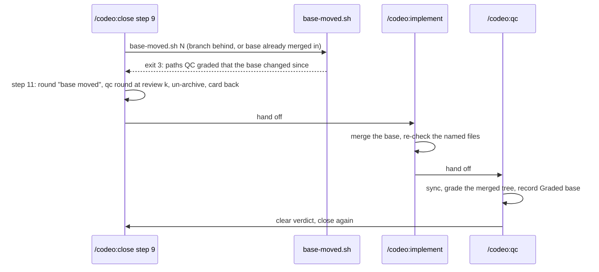

# Parallel Issue Collisions, Round 2 Implementation Plan (#207)

> **For agentic workers:** REQUIRED SUB-SKILL: Use superpowers:subagent-driven-development (recommended) or superpowers:executing-plans to implement this plan task-by-task. Steps use checkbox (`- [ ]`) syntax for tracking.

**Goal:** Fix what `/codeo:qc` round 1 found in the first implementation of #207: `/codeo:close`'s moved-base check cannot route back (F1) and skips an *Update branch* merge (F3); adjacent inventory rules still conflict (F2); `sequenced:` has no clause for two answers (F4); `/codeo:init` prints `holds` for leases nobody holds (F5); and the changelog tool's edge cases (F6).

**Architecture:** The first plan, `docs/plans/2026-11-28-parallel-issue-collisions-207.md`, stands and is built (commits `13ac02c..HEAD` on this branch). This round changes parts of it and adds nothing outside its four mechanisms. Read the state it left before each task: the files named below exist.

| Task | Finding | Answer | Lives in |
|---|---|---|---|
| 1 | F2 | Q9: one blank line between rules, in the page and the pin | `tests/inventory.test.sh`, `docs/skills-inventory.md`, the pin, `tests/inventory-pin.test.sh` |
| 2 | F4 | Q8's neighbour: two more `sequenced:` clauses | `skills/plan/SKILL.md`, rule `plan-11`, `docs/dossier.md` |
| 3 | F5 | Q10: `init` reads the real leases | `skills/init/SKILL.md` |
| 4 | F1, F3 | Q8: a `— base moved` send-back through step 11 | `skills/close/SKILL.md`, `skills/implement/SKILL.md`, `scripts/inflight.sh`, `scripts/dossier-check.sh`, `docs/dossier.md`, `docs/handoff.md`, rule `close-18` |
| 5 | F6 | `tools/changelog.sh` edge cases; the lease test | `tools/changelog.sh`, `tests/intake-lease.test.sh` |
| 6 | docs | the pages that stated untrue things | `README.md`, `docs/skills.md`, `CONTRIBUTING.md`, `docs/release-checklist.md`, `changelog.d/207.md` |
| 7 | all | the whole suite and the footprint | |

**Tech Stack:** bash (4.3+), `jq`, `git`; tests in the `shell` suite (`bash tests/run.sh [pattern]`).

**Spec:** the issue (https://github.com/kbajpai/codeo/issues/207), `.codeo/207/plan.md` (Q1-Q10) and `.codeo/207/qc.md` round 1 (F1-F6).

**How each task is proved.** The one suite is `shell`; it has no single-test filter, but `tests/run.sh <pattern>` runs the files whose name contains the pattern, so a task's proof is `bash tests/run.sh <pattern>` and the last task's is `bash tests/run.sh` (ending `all cases passed`).

## Global Constraints

- **Decisions taken (dossier):** Q8 a `— base moved` round, sent back through step 11 to `/codeo:implement`, and the check also runs when the branch already holds the base (an *Update branch* merge); Q9 one blank line between rules, in the page and the pin; Q10 `init` reads `intake.sh lease list`; F4 two new `sequenced:` clauses (my call, `plan.md` Notes).
- **Reach.** This repository runs the plugin pinned at v1.0.11; skill text written here applies after the next release and pin bump. `scripts/inflight.sh` and `scripts/dossier-check.sh` are plugin scripts: an older reader does not know the `— base moved` round and treats it as an ordinary round (no owed-step hint in `inflight.sh`, and its `qc-round-at-review` check is silent). The release fragment says so.
- **Rules touched.** `plan-11` and `close-18` change text, so Tasks 2 and 4 each run `bash tests/inventory.test.sh --update` and commit the pin. No rule is added or removed.
- **Documentation moved:** `README.md`, `docs/skills.md`, `docs/dossier.md`, `docs/handoff.md`, `CONTRIBUTING.md`, `docs/release-checklist.md` (Tasks 1, 2, 3, 4, 6). Pages describe what the system does, in present tense, with no issue numbers.
- **No invariants document and no shared environment are configured**: no `Needs lease:` task, none runs on the engineer's host.
- **Out of scope (issue):** collisions in run files, leases and the triage ledger (#194, #198); semantic conflicts; splitting #195.
- **This round's footprint is the first round's plus** `scripts/inflight.sh`, `scripts/dossier-check.sh`, `skills/implement/SKILL.md`, `tests/inflight.test.sh`, `tests/dossier-check.test.sh`, `tests/fixtures/dossiers/**`, `tests/implement-skill.test.sh` and this plan file.

## File Structure

| File | Change |
|---|---|
| `tests/inventory.test.sh` | pin lines separated by blanks; a check that rule bullets are separated; an "added rule" case |
| `docs/skills-inventory.md` | a blank line between rule bullets (text unchanged except `plan-11`, `close-18`) |
| `tests/fixtures/skills-inventory.rules.sha256` | regenerated, blank-separated |
| `tests/inventory-pin.test.sh` | adjacent-rules case, appended-rule case |
| `skills/plan/SKILL.md`, `tests/plan-skill.test.sh` | two `sequenced:` clauses |
| `skills/init/SKILL.md`, `tests/init-skill.test.sh` | real leases |
| `skills/close/SKILL.md`, `tests/close-skill.test.sh` | step 9 and step 11 |
| `skills/implement/SKILL.md`, `tests/implement-skill.test.sh` | reads a `— base moved` round |
| `scripts/inflight.sh`, `tests/inflight.test.sh` | the new send-back |
| `scripts/dossier-check.sh`, `tests/dossier-check.test.sh`, `tests/fixtures/dossiers/` | `qc-round-at-review` covers it; two fixtures |
| `tools/changelog.sh`, `tests/changelog.test.sh` | edge cases |
| `tests/intake-lease.test.sh` | the `skill` entry hard-coded |
| `docs/*`, `README.md`, `CONTRIBUTING.md`, `changelog.d/207.md` | documentation |

---

### Task 1: Rules separated by a blank line (F2, Q9)

Git conflicts when two branches change consecutive lines. Rules sit on consecutive lines in `docs/skills-inventory.md` and in the pin, so two branches that reword `plan-01` and `plan-02` conflict in both. With one unchanged line between them both edits merge (checked in a scratch repository).

**Files:** `tests/inventory.test.sh`, `docs/skills-inventory.md`, `tests/fixtures/skills-inventory.rules.sha256`, `tests/inventory-pin.test.sh`, `CONTRIBUTING.md`.

- [ ] **Step 1 — the failing tests.**
  - `tests/inventory-pin.test.sh`: add `adjacent_rules_merge_cleanly`: in the scratch repository (as the existing cases), branch a rewords `plan-01`, branch b rewords `plan-02`, each runs `--update` and commits; the merge exits 0, the merged tree's `bash tests/inventory.test.sh` prints `all cases passed`, `--update` then `git diff --quiet` shows nothing. Add `appended_rules_still_conflict`: both branches append a different `- [qc-99] …` rule after the last `qc` bullet; the merge conflicts and the conflicted files include `docs/skills-inventory.md` (two new rules after one rule is a real conflict).
  - `tests/inventory.test.sh`: add a case that a copy of the page with two rule bullets on consecutive lines fails with `rule <id> is not separated from the rule before it by a blank line` (one FAIL per such bullet, the first bullet of a skill excepted), and that the pin reader ignores blank lines (a pin with extra blank lines passes), and `an_added_rule_is_not_pinned`: appending a `- [qc-99] x` bullet prints `rule qc-99 is not pinned`.
  - Run `bash tests/run.sh inventory`. Expected: the adjacent case and the separation check fail (the page has no blank lines yet).
- [ ] **Step 2 — implement.** In `tests/inventory.test.sh`: `--update` writes one blank line after each pin line; the pin reader skips blank lines; add the separation check as above (a rule bullet whose previous line is another rule's last line, wrapped lines included, is a FAIL). Then separate the page: a blank line between every pair of rule bullets under the eight skill headings of `docs/skills-inventory.md`, bullet texts byte-identical (wrapped bullets keep their indentation). Run `bash tests/inventory.test.sh --update` and commit the fixture; its hashes must not change (compare the `<id><TAB><hash>` columns before and after with `cut`).
- [ ] **Step 3 — the document.** `CONTRIBUTING.md`'s section on the pin says: rules are separated by a blank line so two changes to different rules merge; two changes to the same rule, or two rules appended after the same rule, conflict in `docs/skills-inventory.md`; resolve the page, run `bash tests/inventory.test.sh --update` (it overwrites the fixture whole) and commit it. Remove any claim broader than that.
- [ ] **Step 4 — prove it.** `bash tests/run.sh inventory`, `bash tests/run.sh skills`, `bash tests/run.sh inventory-pin` → each ends `all cases passed`.

**Proof of done:** `bash tests/run.sh inventory-pin` → `all cases passed`.

### Task 2: `sequenced:` clauses for a re-scope and a lock (F4)

Rule `plan-11` says every answered overlap question is written to `sequenced:` and `none` only when none was raised, but gives `after #M` and `beside #M` only; a *re-scope* answer, or an exclusive overlap the lease settles, has no form.

**Files:** `docs/skills-inventory.md` (`plan-11`), `skills/plan/SKILL.md`, `docs/dossier.md`, `tests/plan-skill.test.sh`, the pin.

New `plan-11` text: "An overlap question's answer is written to the footprint's `sequenced:` line before the footprint is committed: `after #M — <why> (Q<k>)` for *sequence after*, `beside #M — <what overlaps> (Q<k>)` for *proceed and coordinate*, `rescoped — <what was dropped> because of #M (Q<k>)` for *re-scope*, `locked — <resource> behind #M (Q<k>)` for an exclusive overlap the lease settles, `none` when no overlap was raised."

- [ ] **Step 1 — failing checks.** In `tests/plan-skill.test.sh`, pin the four clauses by their literal forms in `skills/plan/SKILL.md` and in `docs/dossier.md`'s *The footprint*; run `bash tests/run.sh plan-skill`. Expected: fails.
- [ ] **Step 2 — text.** Update `plan-11` in `docs/skills-inventory.md`; in `skills/plan/SKILL.md` the `plan-11` paragraph (step 10 sub-step 1) and step 10 sub-step 2's pointer to the forms; `docs/dossier.md` *The footprint*'s `sequenced` bullet lists the four clauses and `none`. Run `bash tests/inventory.test.sh --update`; commit the pin.
- [ ] **Step 3 — prove it.** `bash tests/run.sh plan-skill`, `skills`, `inventory`, `dossier-check` → each ends `all cases passed`.

**Proof of done:** `bash tests/run.sh plan-skill` → `all cases passed`.

### Task 3: `/codeo:init` reads the real leases (F5, Q10)

**Files:** `skills/init/SKILL.md`, `tests/init-skill.test.sh`.

`init` step 3 (the paragraph beginning "`inflight.sh`'s footprint lines also give each workflow's `exclusive:`") currently prints `#<M> holds <resources>` from a footprint. Replace it: `init` runs `bash "${CLAUDE_PLUGIN_ROOT}/scripts/intake.sh" lease list --tsv` (rows `held|waiting<TAB>resource<TAB>issue<TAB>by<TAB>since`) and prints one line per row whose issue is not this one: `#<M> holds <resource>` for `held`, `#<M> waits for <resource>` for `waiting`; nothing when there is none. It asks nothing and blocks nothing; a failure of the read (origin unreachable, no resources configured) is reported in one line and the step carries on. The overlap itself is decided at `/codeo:plan`.

- [ ] **Step 1 — failing pins** in `tests/init-skill.test.sh`: the skill names `lease list --tsv`, both line forms, the nothing-when-none sentence, the own-issue exclusion, the one-line failure report, and no longer says the footprint's `exclusive:` line is read. Run `bash tests/run.sh init-skill`. Expected: fails.
- [ ] **Step 2 — text.** Edit the paragraph; keep the unchanged sentence that `overlap.sh` has nothing to compare at `init`.
- [ ] **Step 3 — prove it.** `bash tests/run.sh init`, `bash tests/run.sh skills` → `all cases passed`.

**Proof of done:** `bash tests/run.sh init-skill` → `all cases passed`.

### Task 4: A moved base is a send-back, through step 11 (F1, F3, Q8)

`/codeo:close` step 9 runs with a pull request open, so the dossier is archived under `.codeo/done/<N>/`. `base-moved.sh <N>` (exit 0 nothing; 3 paths on stdout; 4 no `Graded base:` line; 1 cannot judge, one stderr line) reads it from there. Today exit 3 stops with the route `/codeo:qc` and writes nothing, which cannot work: `/codeo:qc` reads `.codeo/<N>/` only. Step 11 already sends a conflict back through `/codeo:implement` by writing a round, un-archiving and moving the card. Exit 3 does the same with a round of its own. The check also runs when the branch already holds the base: `base-moved.sh` compares the graded sha with `origin/<base>` and the branch's own changes (`origin/<base>...HEAD`), so it holds after an *Update branch* merge.

**Files:** `docs/skills-inventory.md` (`close-18`), `skills/close/SKILL.md`, `skills/implement/SKILL.md`, `scripts/inflight.sh`, `scripts/dossier-check.sh`, `docs/dossier.md`, `docs/handoff.md`, `tests/close-skill.test.sh`, `tests/implement-skill.test.sh`, `tests/inflight.test.sh`, `tests/dossier-check.test.sh`, `tests/fixtures/dossiers/`, the pin.

New `close-18` text: "Before a moved base is merged, or when the branch already holds it, `base-moved.sh` names the graded files the base changed since; any path is a send-back to `/codeo:implement` as a `— base moved` round, never a merge."

- [ ] **Step 1 — failing tests.**
  - `tests/dossier-check.test.sh` and `tests/fixtures/dossiers/`: add `good-base-moved` (a `close.md` with a `### Round 2 — base moved` round carrying the paths and `qc round at review: 1`, with a `qc.md` that has round 1; use `good-review-cycle` as the template) and `bad-base-moved-qc-round` (the same round without the `qc round at review:` line; expected output `FAIL close.md [qc-round-at-review] round 2 carries no "qc round at review: <k>"`). Register both in the test's `want` table exactly as the existing fixtures are.
  - `tests/inflight.test.sh`: a case beside the `conflicts with main` one (around line 831): a `close.md` whose last round is `### Round 2 — base moved` makes `inflight.sh` show the workflow as sent back and owing `/codeo:implement` then `/codeo:qc`, exactly as for `— conflicts with main`.
  - `tests/close-skill.test.sh` (replace the exit-3 pins of the old route): in step 9, `base-moved.sh <N>` runs after the pull and before any merge, and whether or not the branch is `BEHIND`; exit 0 and 4 carry on as before (exit 4 with its one line); exit 3 merges nothing and goes to step 11, whose round is headed `### Round <n> — base moved`, lists each path, carries `qc round at review: <k>`, un-archives, moves the card back, and hands off to `/codeo:implement`; exit 1 stops quoting the stderr line; the text no longer says nothing is written to `close.md` for exit 3.
  - `tests/implement-skill.test.sh`: step 3 names a `— base moved` round: the base changed files QC graded; step 2a's merge brought it in; re-check each named file against the plan and record the check in the round's outcome; then `/codeo:qc`.
  - Run `bash tests/run.sh dossier-check`, `inflight`, `close-skill`, `implement-skill`. Expected: each fails on the new cases.
- [ ] **Step 2 — scripts.** `scripts/inflight.sh` `close_send_back` (line 217's pattern) matches `base moved` besides `review feedback|conflicts with`, and its two header comments say so; `scripts/dossier-check.sh`'s `check_qc_round_at_review` heading pattern matches `— base moved` besides the two it has, and the header's `qc-round-at-review` line and the finding text name it.
- [ ] **Step 3 — skills and docs.** `skills/close/SKILL.md`: step 9's bullet becomes a check that runs on every pass of step 9 after the pull (before the `BEHIND` handling), with the `close-18` marker and the exits above; step 11's first paragraph and its round list name `— base moved` (a round of `### Round <n> — base moved`, the paths from `base-moved.sh` in place of a review's points, the card and un-archive steps as for the other send-backs, subject `docs(codeo): close dossier for #<N> — base moved`); `skills/implement/SKILL.md` step 3 and its Hand-off `Reads` line; `docs/dossier.md` (the close round forms near line 299, the send-back text near lines 307 and 332-333, and *Send-backs*) and `docs/handoff.md` (*A send-back*) list the new round. Update `close-18` in `docs/skills-inventory.md` and run `bash tests/inventory.test.sh --update`; commit the pin.
- [ ] **Step 4 — prove it.** `bash tests/run.sh dossier-check`, `inflight`, `close`, `implement`, `skills`, `inventory`, `replay` → each ends `all cases passed`.

**Proof of done:** `bash tests/run.sh close-skill` → `all cases passed`.

### Task 5: The changelog tool's edge cases and the lease test (F6)

**Files:** `tools/changelog.sh`, `tests/changelog.test.sh`, `tests/intake-lease.test.sh`.

- [ ] **Step 1 — failing cases** in `tests/changelog.test.sh`: (a) two fragments whose `Safe to bump mid-workflow:` values are `no — a` and `no — b` assemble with `Safe to bump mid-workflow: no — a; b`; `yes` against `no — a` gives `no — a`; two `yes` or none give `yes`; `Config schema:` disagreement still exits 1 with the existing message; (b) `assemble` exits 1 with `changelog: CHANGELOG.md already has a section for <version>` when the heading exists and with `changelog: CHANGELOG.md has an ## Unreleased heading; fold it into a fragment first` when it has one; both write and delete nothing; (c) a fragment with CRLF line endings assembles with no `\r` in `CHANGELOG.md`; (d) trailing blank lines in a fragment do not appear between bullets. In `tests/intake-lease.test.sh`: the test's resource list hard-codes the `{"name":"skill","paths":["skills/**","tests/*-skill.test.sh"],"parameterised":true}` entry in place of reading the repository's config, and the case `the_repo_declares_the_skill_resource` stays (it is the one read of the real config). Run `bash tests/run.sh changelog` and `intake-lease`. Expected: the new changelog cases fail.
- [ ] **Step 2 — implement** in `tools/changelog.sh` to the behaviour above (`no` wins; reasons joined with `; ` after dropping each repeated `no — ` prefix; the two refusals; `\r` stripped on read; trailing blank lines trimmed per fragment).
- [ ] **Step 3 — prove it.** `bash tests/run.sh changelog`, `bash tests/run.sh intake-lease` → `all cases passed`.

**Proof of done:** `bash tests/run.sh changelog` → `all cases passed`.

### Task 6: The pages that said untrue things

Documentation-only; proved by the documentation checks and by every link resolving.

- [ ] **Step 1 — the pages**, each describing what the system does:
  - `README.md` and `docs/skills.md`: `/codeo:init` prints `#<M> holds <resource>` and `#<M> waits for <resource>` from `intake.sh lease list`; `/codeo:close` sends a moved base that touched graded files back to `/codeo:implement` as a `— base moved` round (also when the branch already holds the base through an *Update branch* merge), then `/codeo:qc` grades the merged tree; `/codeo:plan` records the four `sequenced:` clauses.
  - `docs/release-checklist.md` step 6: `assemble` refuses a leftover `## Unreleased` heading and a version that already has a section; fold or remove first.
  - `CONTRIBUTING.md`: the changelog section says `no` wins the `Safe to bump mid-workflow:` header and the reasons are joined; the pin section is Task 1's.
  - `changelog.d/207.md`: rewrite bullets 2-4 and the `Shared state:` line to match: the pin is one line per rule, blank-separated, so two changes to different rules merge and two to the same rule conflict in the page; the `skill` lease; `sequenced:` records every answered overlap question in four forms; `Graded base:` and `Behind:` in `qc.md` rounds; the new `— base moved` round in `close.md`, which an older `inflight.sh` and `dossier-check.sh` read as an ordinary round; `base-moved.sh`; `/codeo:init` naming real leases.
- [ ] **Step 2 — prove it.** `bash tests/run.sh readme`, `skills-doc`, `changelog`, `dossier-check` → each ends `all cases passed`; grep the added lines of the pages for issue numbers and `now`, `no longer`, `previously`: none.

**Proof of done:** `bash tests/run.sh skills-doc` → `all cases passed`.

### Task 7: The whole suite and the footprint

- [ ] **Step 1.** `bash tests/inventory.test.sh --update`; commit the fixture only if it changed.
- [ ] **Step 2.** `bash tests/run.sh` → ends `all cases passed`; `bash scripts/overlap.sh --outside 207` → prints nothing.
- [ ] **Step 3 — the findings, each by its proof.** F1/F3 `bash tests/run.sh close-skill` and `dossier-check`; F2 `bash tests/run.sh inventory-pin`; F4 `bash tests/run.sh plan-skill`; F5 `bash tests/run.sh init-skill`; F6 `bash tests/run.sh changelog`.

**Proof of done:** `bash tests/run.sh` → `all cases passed`.

## Self-review

- Every blocking finding of `qc.md` round 1 (F1-F5) has a task and a proof; F6 and the carried minors are Task 5 and Task 1's added case.
- Not done by design: CRLF in a `Graded base:` line and a version section for a non-release are not guarded beyond what `base-moved.sh` already does; a conflict from two branches appending a rule after the same rule is a real conflict and is documented (Task 1).
- `/codeo:close` run by the pinned v1.0.11 plugin does not yet write the new round; the first pull request that benefits is the one after the next release and pin bump.
