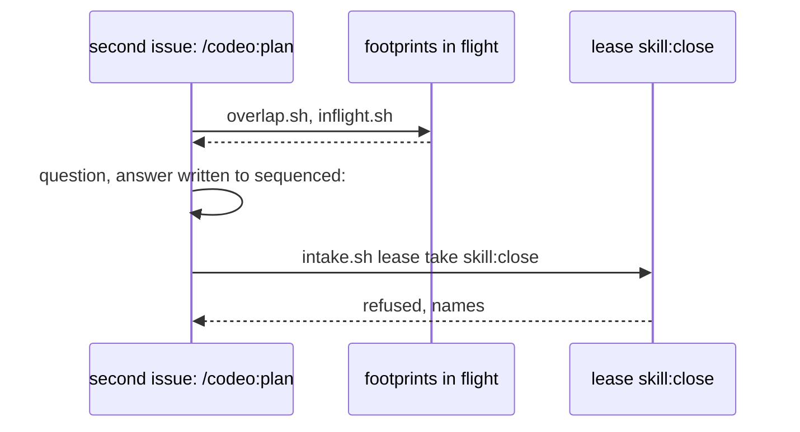
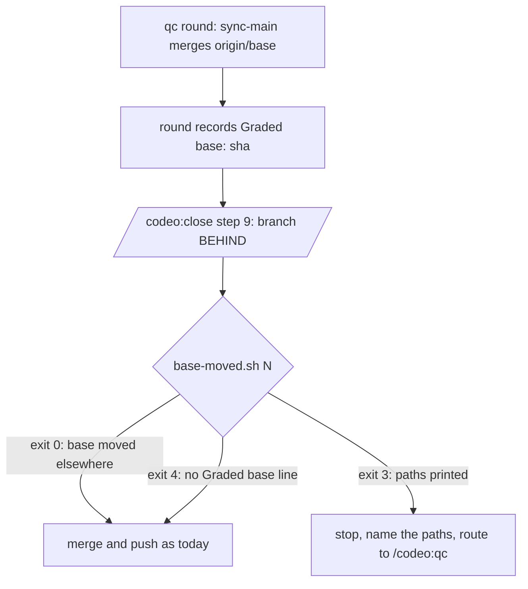

# Parallel Issue Collisions Implementation Plan (#207)

> **For agentic workers:** REQUIRED SUB-SKILL: Use superpowers:subagent-driven-development (recommended) or superpowers:executing-plans to implement this plan task-by-task. Steps use checkbox (`- [ ]`) syntax for tracking.

**Goal:** Parallel issues stop colliding on the files every branch edits, and the workflow acts on the collisions that remain: changelog entries live in a file of their own per issue, the inventory pin is one line per rule so different-rule changes merge, an overlap on a skill is a lock and every overlap decision is recorded in the footprint, and `/codeo:close` never merges a moved base into a branch whose graded files it changed without a new QC round.

**Architecture:** Four independent mechanisms in one pull request, ordered so each group is provable alone.

| Part | Mechanism | Lives in |
|---|---|---|
| A | `changelog.d/<N>.md` fragments, assembled at release | `tools/changelog.sh` (this repository only, Q1), `CONTRIBUTING.md`, release checklist, the plan overlay |
| B | The inventory pin: one `<id><TAB><sha256>` line per rule | `tests/inventory.test.sh`, `tests/fixtures/skills-inventory.rules.sha256` |
| C | A parameterised exclusive resource `skill` (lock), and `sequenced:` records every overlap decision | `.codeo/config.json`, `skills/plan/SKILL.md`, `skills/init/SKILL.md` |
| D | `Graded base:` recorded by QC, checked by `scripts/base-moved.sh` before `/codeo:close` merges | `skills/qc/SKILL.md`, `skills/close/SKILL.md`, `scripts/base-moved.sh` |





**Tech Stack:** bash (4.3+), `jq`, `git`; tests in the `shell` suite (`bash tests/run.sh [pattern]`).

**Spec:** the issue (https://github.com/kbajpai/codeo/issues/207) and `.codeo/207/plan.md` (Q1-Q7, answered). No reference doc: every decision is a choice among options the dossier records.

**How each task is proved.** The one suite is `shell`; it has no single-test filter, but `tests/run.sh <pattern>` runs the files whose name contains the pattern, so a task's proof is `bash tests/run.sh <pattern>` and the last task's is `bash tests/run.sh` (the suite's whole `test` command, ending `all cases passed`).

## Global Constraints

- **Decisions already taken (dossier):** Q1 this repository only; Q2 per-issue fragment with header contributions, bullets in issue-number order; Q3 one pin line per rule; Q4 both the lock and the recorded decision; Q5 `init` informs, `/codeo:plan` gates; Q6 pin what exists and close the after-verdict gap with `Graded base:`; Q7 proceed beside #213.
- **Reach.** This repository runs the plugin pinned at v1.0.10, so skill text written here applies here after the next release and pin bump (separate issues). The `skill` resource and the `intake.sh lease` code it uses are already in v1.0.10, and the plan overlay (Task 2) carries the suffix rule until the pin moves.
- **This plan's own footprint says `exclusive: none`.** The `skill` resource does not exist until this branch merges, so there is nothing to lease; `sequenced:` records #213 (Q7).
- **Documentation moved:** `README.md`, `docs/skills.md`, `docs/dossier.md`, `docs/handoff.md`, `docs/skills-inventory.md`, `docs/release-checklist.md`, `CONTRIBUTING.md` (Task 12). The `CHANGELOG.md` entry is the first fragment, `changelog.d/207.md` (Task 13); this branch does not edit `CHANGELOG.md`.
- **No invariants document and no shared environment are configured**, so there is no invariant check and no task carries `Needs lease:`. Every task runs in this checkout; none carries `Runs on:`.
- **Out of scope (issue):** collisions in run files, leases and the triage ledger (#194, #198); auto-resolving semantic conflicts; splitting #195. Later steps' overlap answers (`implement`, `qc`, `close`) stay in their own dossiers: only `/codeo:plan` writes `sequenced:`.
- **New inventory rules** (Tasks 7, 10, 11), IDs consecutive: `plan-11`, `qc-16`, `close-18`. Each needs its `<!-- rule: <id> -->` comment in the skill, which `tests/skills.test.sh` checks.
- **Order of the inventory pin work.** Task 3 changes the pin's format and regenerates it; every later task that changes `docs/skills-inventory.md` runs `bash tests/inventory.test.sh --update` and commits the fixture.

## File Structure

| File | Change |
|---|---|
| `tools/changelog.sh` | new: `assemble`, `cat` |
| `tests/changelog.test.sh`, `tests/fixtures/changelog/` | new |
| `changelog.d/207.md` | new: this issue's entry |
| `.codeo/overlays/plan.md` | add `## plan-shape` |
| `tests/inventory.test.sh` | per-rule pin, `want` table removed |
| `tests/inventory-pin.test.sh` | new: the two-branch merge |
| `tests/fixtures/skills-inventory.rules.sha256` | regenerated, one line per rule |
| `.codeo/config.json` | `resources`: `skill` |
| `tests/intake-lease.test.sh`, `tests/overlap.test.sh` | new cases |
| `scripts/base-moved.sh`, `tests/base-moved.test.sh` | new |
| `skills/plan|init|qc|close/SKILL.md`, `tests/<skill>-skill.test.sh` | text and pins |
| `docs/skills-inventory.md` | rules `plan-11`, `qc-16`, `close-18` |
| `README.md`, `docs/skills.md`, `docs/dossier.md`, `docs/handoff.md`, `docs/release-checklist.md`, `CONTRIBUTING.md` | documentation |

### Footprint

```
files:      tools/changelog.sh, tests/changelog.test.sh, tests/fixtures/changelog/**, changelog.d/**, .codeo/overlays/plan.md, .codeo/config.json, tests/inventory.test.sh, tests/inventory-pin.test.sh, tests/fixtures/skills-inventory.rules.sha256, tests/intake-lease.test.sh, tests/overlap.test.sh, scripts/base-moved.sh, tests/base-moved.test.sh, skills/plan/SKILL.md, skills/init/SKILL.md, skills/qc/SKILL.md, skills/close/SKILL.md, tests/plan-skill.test.sh, tests/init-skill.test.sh, tests/qc-skill.test.sh, tests/close-skill.test.sh, docs/skills-inventory.md, docs/skills.md, docs/dossier.md, docs/handoff.md, docs/release-checklist.md, README.md, CONTRIBUTING.md, docs/plans/2026-11-28-parallel-issue-collisions-207.md
wiki:       none
exclusive:  none
sequenced:  beside #213 — it pins the plugin and edits README.md and .codeo/config.json (Q7)
```

---

## Part A — Changelog fragments

### Task 1: `tools/changelog.sh`

A fragment `changelog.d/<N>.md` (`<N>` digits) is optional header lines first, a blank line, then the body (bullets, as written in `CHANGELOG.md`):

```
Shared state: adds `.codeo/intake/x`
Safe to bump mid-workflow: no — finish open workflows first

- The change, in one bullet (#<N>).
```

Header lines are exactly `Config schema: `, `Shared state: ` and `Safe to bump mid-workflow: ` at the start of a line before the first blank line.

**Interface**

- `tools/changelog.sh assemble vX.Y.Z YYYY-MM-DD` — reads `changelog.d/[0-9]*.md` in numeric order and inserts, above the first `## v` heading of `CHANGELOG.md`, the section `## vX.Y.Z — YYYY-MM-DD`, a blank line, the three header lines, a blank line, then every fragment's body in order (fragments separated by nothing: each body's bullets follow the last), and a blank line. Header values: `Config schema:` defaults to `1 (unchanged)`; `Safe to bump mid-workflow:` defaults to `yes`; `Shared state:` is every fragment's value joined with `; ` (`none` when no fragment has one or every value is `none`). For the first two, two fragments with different values stop the run: stderr `changelog: fragments disagree on <key>: #<a> says <x>, #<b> says <y>`, exit 1, nothing written. It then deletes the fragments it read. It writes only `CHANGELOG.md` and removes only fragments; the engineer commits.
- `tools/changelog.sh cat` — prints `CHANGELOG.md`, then every fragment, so a test that looks for an entry finds it before and after release.
- Exit 2 and a usage line on any other call; exit 1 with `changelog: no fragments in changelog.d` when `assemble` finds none.

**Files:** `tools/changelog.sh`, `tests/changelog.test.sh`, `tests/fixtures/changelog/` (`base.md`: a `# Changelog` and one old section; `frag-12.md`, `frag-30.md`, `frag-31.md`; `expected.md`: the `base.md` with the section the current process would write for them).

- [ ] **Step 1 — the failing test.** `tests/changelog.test.sh` copies `tools/changelog.sh` into a scratch directory beside a `CHANGELOG.md` and `changelog.d/` built from the fixtures and runs it there, with these cases (follow `tests/sync-main.test.sh` for the scratch-git helpers):
  1. `assemble_matches_the_hand_written_section`: `assemble v9.9.9 2026-12-01` over `frag-12`, `frag-30`, `frag-31` gives `CHANGELOG.md` equal to `fixtures/changelog/expected.md`, and `changelog.d/` holds no fragment afterwards. The fixture has a fragment with a `Shared state:` line, one with `Safe to bump mid-workflow: no — …` alone, and one with none, so the joined, overridden and default header values are all covered. Fragment 12's bullets come before 30's whatever the file order on disk.
  2. `disagreeing_headers_stop`: two fragments with different `Safe to bump mid-workflow:` values exit 1 with the message above, and `CHANGELOG.md` and both fragments are unchanged.
  3. `no_fragments`: exit 1, the message above.
  4. `two_branches_merge_without_a_conflict`: in a scratch git repository holding `CHANGELOG.md`, two branches each add one fragment (`changelog.d/40.md`, `changelog.d/41.md`) and merge: exit 0, no conflict. `assemble` on the merged tree then holds both bullets.
  5. `cat_reads_the_file_and_the_fragments`: `cat` prints a bullet from `CHANGELOG.md` and one from a fragment.
- [ ] **Step 2 — see it fail.** Run `bash tests/run.sh changelog`. Expected: `FAIL` on every case (`tools/changelog.sh: No such file or directory`), exit 1.
- [ ] **Step 3 — write `tools/changelog.sh`** (bash 4.3, `set -euo pipefail`, awk for the file edit, no network) to the interface above.
- [ ] **Step 4 — prove it.** Run `bash tests/run.sh changelog`. Expected: `all cases passed`.
- [ ] **Step 5 — the release-equivalence check.** Run, in a scratch copy of `CHANGELOG.md`'s v1.0.11 bullets split into one fragment each: `tools/changelog.sh assemble v1.0.11 2026-11-27` produces v1.0.11's bullet set, as a sorted list of lines compared with `comm` against `CHANGELOG.md`'s. Record the result in `implement.md` (bullet order differs by design: Q2).

**Proof of done:** `bash tests/run.sh changelog` → `all cases passed`.

### Task 2: The convention, the checklist and the plan overlay

**Files:** `CONTRIBUTING.md`, `docs/release-checklist.md`, `.codeo/overlays/plan.md`.

- [ ] **Step 1 — the failing check.** Add to `tests/changelog.test.sh` the case `the_documents_name_the_fragment_flow`: `CONTRIBUTING.md` contains `changelog.d/<issue>.md` and `tools/changelog.sh`; `docs/release-checklist.md` contains `tools/changelog.sh assemble` and no longer tells the engineer to retitle `## Unreleased`; `.codeo/overlays/plan.md` has a `## plan-shape` section naming `changelog.d/`. Run `bash tests/run.sh changelog`. Expected: that case fails.
- [ ] **Step 2 — write them.**
  - `CONTRIBUTING.md`, a `## Changelog entries` section: an issue's entry is `changelog.d/<issue>.md` (format as in Task 1); `CHANGELOG.md` is edited only by `tools/changelog.sh assemble`; a test that looks for an entry reads `tools/changelog.sh cat`.
  - `docs/release-checklist.md` step 6: replace "retitle `CHANGELOG.md`'s `## Unreleased` as `## vX.Y.Z — YYYY-MM-DD`" with: run `bash tools/changelog.sh assemble vX.Y.Z YYYY-MM-DD` and commit `CHANGELOG.md` and the deleted fragments; read the `Shared state:` line it writes against the dossier conventions the step names. The UTC-date sentence stays.
  - `.codeo/overlays/plan.md`, `## plan-shape`: "A change's changelog entry is a documentation task that writes `changelog.d/<issue>.md`, never `CHANGELOG.md`. Footprints list `changelog.d/**`. The `exclusive:` suffix for the `skill` resource is the path segment the first wildcard of the matching glob stands for (`skills/close/SKILL.md` and `tests/close-skill.test.sh` both give `skill:close`)." The sections `## plan-shape` and `## role-guard` are known overlay points; `/codeo:doctor`'s `overlays` check must stay green.
- [ ] **Step 3 — prove it.** `bash tests/run.sh changelog`, then `bash tests/run.sh overlay`, `bash tests/run.sh doctor`. Expected: `all cases passed` for each.

**Proof of done:** `bash tests/run.sh changelog` → `all cases passed`.

---

## Part B — The inventory pin

### Task 3: One pin line per rule

**Files:** `tests/inventory.test.sh`, `tests/fixtures/skills-inventory.rules.sha256`.

The rule text stream (`rules_stream`) is unchanged. The pin becomes `rules_pin`: for each stream line `<id><TAB><text>`, the line `<id><TAB><sha256 of text>`. The `want` count table goes: the pin lists every ID, so a rule dropped or added shows as a missing or extra pin line. A mismatch prints one `FAIL` per differing ID — `rule <id> differs from the pin`, `rule <id> is not pinned`, `pinned rule <id> is gone` — then the unchanged hint to run `--update`.

- [ ] **Step 1 — rewrite the test's cases first**, still over scratch copies: a reworded `issue-01` makes exactly `rule issue-01 differs from the pin` fail; swapping two IDs fails two lines; a dropped `qc-13` prints `pinned rule qc-13 is gone`; an untouched copy has an identical pin. Add the same checks as assertions on the printed lines.
- [ ] **Step 2 — see it fail.** Run `bash tests/run.sh inventory`. Expected: fails (the fixture is still a single hash).
- [ ] **Step 3 — implement `rules_pin`, `--update` writing it, and the comparison**; run `bash tests/inventory.test.sh --update`, commit the regenerated fixture (87 lines, `<id><TAB><64 hex>`).
- [ ] **Step 4 — prove it.** `bash tests/run.sh inventory` → `all cases passed`; `bash tests/run.sh skills` → `all cases passed` (the lint reads the inventory).

**Proof of done:** `bash tests/run.sh inventory` → `all cases passed`.

### Task 4: Two rule changes merge

**Files:** `tests/inventory-pin.test.sh`.

- [ ] **Step 1 — the test.** In a scratch git repository holding a copy of `docs/skills-inventory.md`, `tests/inventory.test.sh` and the fixture (the test finds its repo from its own location): branch `a` rewords rule `plan-01` and runs `bash tests/inventory.test.sh --update`, branch `b` rewords `qc-01` and does the same, each commits. `git merge` of one into the other exits 0 with no conflict; in the merged tree `bash tests/inventory.test.sh` prints `all cases passed`, and `--update` followed by `git diff --quiet` shows it changed nothing. A second case, `the_same_rule_still_conflicts`, rewords `plan-01` differently on both branches: the merge conflicts, and the conflicted file is `docs/skills-inventory.md`, which is the real conflict.
- [ ] **Step 2 — prove it.** `bash tests/run.sh inventory-pin` → `all cases passed`. (It passes once Task 3 is in; before Task 3 it fails on the merge.)

**Proof of done:** `bash tests/run.sh inventory-pin` → `all cases passed`.

---

## Part C — The overlap rule

### Task 5: The `skill` resource

**Files:** `.codeo/config.json`, `tests/intake-lease.test.sh`.

- [ ] **Step 1 — the failing test.** In `tests/intake-lease.test.sh`, extend `resources` (the array near the top) with the entries of this repository's `.codeo/config.json` `.resources` (`jq -c`), and add `skill_resource_serialises_one_skill`: `lease take skill:close 1 x` succeeds; `lease take skill:close 2 y` exits 1 with `skill:close is leased to #1`; `lease take skill:plan 2 y` succeeds; `lease take skill 2 y` is refused with `unknown resource skill`. Add `the_repo_declares_the_skill_resource`: `jq -e '.resources[] | select(.name == "skill" and .parameterised == true and (.paths | index("skills/**")) and (.paths | index("tests/*-skill.test.sh")))' .codeo/config.json`. Run `bash tests/run.sh intake-lease`. Expected: both fail.
- [ ] **Step 2 — config.** `"resources": [{"name": "skill", "paths": ["skills/**", "tests/*-skill.test.sh"], "parameterised": true}]`.
- [ ] **Step 3 — prove it.** `bash tests/run.sh intake-lease` and `bash tests/run.sh doctor` → `all cases passed`. `scope.sh` uses `resources[].paths` only for the environment resource, so `bash tests/run.sh scope` must be unchanged.

**Proof of done:** `bash tests/run.sh intake-lease` → `all cases passed`.

### Task 6: An overlap names the other issue and the files

**Files:** `tests/overlap.test.sh`.

- [ ] **Step 1 — the case.** Using the file's helpers for an in-flight branch with a pushed footprint: workflow #M's footprint is `files: skills/close/SKILL.md` and `exclusive: skill:close`; this issue's footprint names `skills/close/SKILL.md` and `exclusive: skill:close`. Assert `overlap.sh <N>` prints `M<TAB>skills/close/SKILL.md` and `M<TAB>exclusive:skill:close` (the issue and each overlapping thing), and that after a `### Q` block quoting `#M` and `skills/close/SKILL.md` is added to this issue's `plan.md`, the file's line no longer prints while `exclusive:skill:close` still does. Add the same for `skills/plan/SKILL.md` against a footprint naming `skill:plan`, which must not pair with `skill:close`.
- [ ] **Step 2 — prove it.** `bash tests/run.sh overlap` → `all cases passed`. If a case fails because `overlap.sh` does not pair `exclusive:` names, fix `scripts/overlap.sh` minimally and say so in `implement.md`.

**Proof of done:** `bash tests/run.sh overlap` → `all cases passed`.

### Task 7: `/codeo:plan` — the suffix, the lock and the recorded decision

**Files:** `docs/skills-inventory.md`, `skills/plan/SKILL.md`, `tests/plan-skill.test.sh`, the pin.

New rule, `plan-11` in the `## plan` section: "An overlap question's answer is written to the footprint's `sequenced:` line before the footprint is committed: `after #M — <why> (Q<k>)` for *sequence after*, `beside #M — <what overlaps> (Q<k>)` for *proceed and coordinate*, `none` when no overlap was raised."

- [ ] **Step 1 — failing checks.** Add the rule to `docs/skills-inventory.md` (the rule count for `plan` is now 11); run `bash tests/run.sh skills`. Expected: the lint fails — `plan-11` has no `<!-- rule: plan-11 -->` in `skills/plan/SKILL.md`. In `tests/plan-skill.test.sh` add pins (follow its existing `doc_has`-style helpers): the skill states the suffix derivation (`the path segment the first wildcard` of the matching glob), that a file under a configured resource's `paths` is listed under `exclusive:` and not left to judgment, the three `sequenced:` forms, and that step 10 takes the lease and a refusal names the holder. Run `bash tests/run.sh plan-skill`. Expected: fails.
- [ ] **Step 2 — the skill text.** In `skills/plan/SKILL.md`: step 8's `exclusive:` paragraph gains the derivation and the "listed, not optional" rule; the overlap-question paragraph (step 8) and step 10 sub-step 2 gain the `plan-11` rule with its comment; step 10 sub-step 3 says a refusal names the holder and the wait is recorded, as today.
- [ ] **Step 3 — prove it.** `bash tests/inventory.test.sh --update`, then `bash tests/run.sh skills`, `bash tests/run.sh plan-skill`, `bash tests/run.sh inventory`, `bash tests/run.sh dossier-check`. Expected: `all cases passed` for each.

**Proof of done:** `bash tests/run.sh plan-skill` → `all cases passed`.

### Task 8: `/codeo:init` informs

**Files:** `skills/init/SKILL.md`, `tests/init-skill.test.sh`.

- [ ] **Step 1 — failing pin.** `tests/init-skill.test.sh`: the skill says `init` names every other workflow whose footprint's `exclusive:` is not `none` (from `inflight.sh`), asks nothing and blocks nothing, and that `/codeo:plan` is where an overlap is decided. Run `bash tests/run.sh init-skill`. Expected: fails.
- [ ] **Step 2 — text.** In step 3 (after the sentence ending "`init`'s check is `inflight.sh` alone, deliberately"), add: `inflight.sh`'s footprint lines also give each workflow's `exclusive:` and `sequenced:`; `init` prints one line per workflow whose `exclusive:` is not `none` — `#<M> holds <resources>` — before it cuts the branch, as information only; the overlap itself is decided at `/codeo:plan`, where there is a footprint to compare.
- [ ] **Step 3 — prove it.** `bash tests/run.sh init` → `all cases passed`.

**Proof of done:** `bash tests/run.sh init-skill` → `all cases passed`.

---

## Part D — Rebase check before QC

### Task 9: `scripts/base-moved.sh`

```
base-moved.sh <N>
  Reads the last "Graded base: <sha>" line of .codeo/<N>/qc.md (else .codeo/done/<N>/qc.md).
  Prints, one per line, every path that origin/<base> changed since <sha> and that this branch also
  changed (git diff --name-only <sha> origin/<base>, intersected with
  git diff --name-only origin/<base>...HEAD), sorted bytewise.
  Exit 0: nothing printed. Exit 3: paths printed. Exit 4: qc.md has no "Graded base:" line (a round
  written before this script); prints "base-moved: no Graded base line in <file>". Exit 1: anything
  else it cannot judge (no qc.md, <sha> is not a commit, the fetch failed): one "base-moved: …" line.
```

It runs `git fetch -q origin <base>` first, with `<base>` from `codeo_base_branch` in `lib/env.sh`, as `sync-main.sh` does.

**Files:** `scripts/base-moved.sh`, `tests/base-moved.test.sh`.

- [ ] **Step 1 — the failing test** over scratch repositories (origin plus clone, as `tests/sync-main.test.sh` does): the branch changes `a.txt` and holds a `qc.md` whose last line is `Graded base: <sha of origin/main>`. (1) `main` adds a commit touching `b.txt` only → exit 0, no output. (2) `main` adds one touching `a.txt` and `b.txt` → exit 3, prints `a.txt`. (3) an earlier `Graded base:` line is ignored when a later one exists. (4) no such line → exit 4. (5) a sha that is not a commit → exit 1. (6) `qc.md` under `done/<N>/` is read when the live one is absent. (7) `main` has not moved → exit 0.
- [ ] **Step 2 — see it fail.** `bash tests/run.sh base-moved` → fails (`scripts/base-moved.sh: No such file`).
- [ ] **Step 3 — write the script** (bash 4.3, `source lib/env.sh`, `LC_ALL=C comm -12` on sorted lists, as `sync-main.sh` does).
- [ ] **Step 4 — prove it.** `bash tests/run.sh base-moved` → `all cases passed`.

**Proof of done:** `bash tests/run.sh base-moved` → `all cases passed`.

### Task 10: `/codeo:qc` records what it graded

**Files:** `docs/skills-inventory.md`, `skills/qc/SKILL.md`, `tests/qc-skill.test.sh`, `docs/dossier.md` (form), the pin.

Rule `qc-16` in `## qc`: "Each round records the `origin/<base>` commit it graded on a `Graded base: <sha>` line, and a round that merged base commits first says how many."

- [ ] **Step 1 — failing checks.** Add `qc-16`; `bash tests/run.sh skills` fails (no comment in the skill). `tests/qc-skill.test.sh` pins: step 2 runs `sync-main.sh --abort-on-conflict` before `git diff origin/<base>...HEAD --stat` (the order is asserted by line number in the file); a conflict routes to `/codeo:implement` without grading; the round has a `Graded base:` line written from `git rev-parse origin/<base>` after the sync; and a `Behind:` line `Behind: merged <n> commit(s) from origin/<base> before grading` when the sync merged, none when the branch already contained base. Run `bash tests/run.sh qc-skill`. Expected: fails on the last two pins only (the first two describe what exists).
- [ ] **Step 2 — text.** `skills/qc/SKILL.md` step 2 and the round's record, with `<!-- rule: qc-16 -->`; `docs/dossier.md` adds the two lines to the `qc.md` round form.
- [ ] **Step 3 — prove it.** `bash tests/inventory.test.sh --update`, then `bash tests/run.sh qc-skill`, `bash tests/run.sh skills`, `bash tests/run.sh dossier-check`, `bash tests/run.sh sync-main` → `all cases passed`.

**Proof of done:** `bash tests/run.sh qc-skill` → `all cases passed`.

### Task 11: `/codeo:close` does not merge past a graded file

**Files:** `docs/skills-inventory.md`, `skills/close/SKILL.md`, `tests/close-skill.test.sh`, the pin.

Rule `close-18` in `## close`: "A `BEHIND` branch is brought up to date only when `base-moved.sh` prints no path; a path both sides changed since the graded base goes back to `/codeo:qc`."

- [ ] **Step 1 — failing checks.** Add `close-18`; `bash tests/run.sh skills` fails. `tests/close-skill.test.sh` pins: step 9's `BEHIND` bullet runs `base-moved.sh <N>` after the `merge-tree` check and before `git merge --no-edit`; exit 0 and exit 4 carry on as today (exit 4 says one line that the round predates `Graded base:`); exit 3 merges nothing, names each path, and stops with the route `/codeo:qc`, writing nothing to `close.md` (this phase writes nothing until a send-back); exit 1 stops, quoting the line. Run `bash tests/run.sh close-skill`. Expected: fails.
- [ ] **Step 2 — text.** `skills/close/SKILL.md` step 9, with `<!-- rule: close-18 -->`. `/codeo:qc` run on that branch syncs `origin/<base>` itself, so the merged tree is graded and the next `Graded base:` replaces the old.
- [ ] **Step 3 — prove it.** `bash tests/inventory.test.sh --update`, then `bash tests/run.sh close`, `bash tests/run.sh skills` → `all cases passed`.

**Proof of done:** `bash tests/run.sh close-skill` → `all cases passed`.

---

## Documentation and the release entry

### Task 12: The pages that went wrong

Documentation-only; proved by the documentation checks (`tests/readme.test.sh`, `tests/skills-doc.test.sh`) and by every link resolving.

- [ ] **Step 1 — the pages**, each saying what the system does and linking here and the dossier for why:
  - `README.md`: `/codeo:plan` section — the `skill` resource and what a refusal looks like; `/codeo:init` — it names workflows holding a lease; `/codeo:qc` — `Graded base:` and `Behind:`; `/codeo:close` — a moved base that touched graded files goes back to QC; Configuration — an example `resources` entry for a parameterised per-directory resource.
  - `docs/skills.md`: the same four entries.
  - `docs/dossier.md`: *The footprint* — `sequenced:` holds one clause per answered overlap question (`after #M — … (Q<k>)`, `beside #M — … (Q<k>)`), `none` only when none was raised; the `qc.md` round form (Task 10).
  - `docs/handoff.md` → *Parallel workflows*: skill files are leased by directory.
  - `docs/skills-inventory.md`: the three rules (done in Tasks 7, 10, 11); `docs/release-checklist.md` and `CONTRIBUTING.md` (Task 2).
  - A diagram that changes: none beyond the two in this plan; the footprint and lease sequence is drawn in `docs/handoff.md`'s existing parallel-workflows section as Mermaid if the section has one, and the diagram is updated, not added, then.
- [ ] **Step 2 — prove it.** `bash tests/run.sh readme`, `bash tests/run.sh skills-doc` → `all cases passed`.

**Proof of done:** `bash tests/run.sh skills-doc` → `all cases passed`.

### Task 13: The release entry, the pin and the whole suite

- [ ] **Step 1 — the fragment.** Write `changelog.d/207.md`: `Shared state:` (the new `Graded base:` and `Behind:` lines in `qc.md`; `sequenced:` now records every overlap decision; the `skill` lease per directory; the pin file's new format) and the bullets — fragments and `tools/changelog.sh`, the per-rule pin, the `skill` lease and `sequenced:` record, `Graded base:` and `base-moved.sh` — each ending `(#207)`.
- [ ] **Step 2 — the pin.** `bash tests/inventory.test.sh --update`; commit the fixture if it changed.
- [ ] **Step 3 — the whole suite.** `bash tests/run.sh`. Expected: it ends `all cases passed`, exit 0. `bash scripts/overlap.sh --outside 207` prints nothing (every changed path is in the footprint).
- [ ] **Step 4 — the acceptance criteria**, each by its command: 1 `bash tests/run.sh changelog`; 2 `bash tests/run.sh inventory-pin`; 3 `bash tests/run.sh overlap` and `bash tests/run.sh intake-lease`; 4 `bash tests/run.sh base-moved` and `bash tests/run.sh qc-skill`; 5 `bash tests/run.sh`.

**Proof of done:** `bash tests/run.sh` → `all cases passed`.

## Self-review

- Every acceptance criterion maps to a task and a command (Task 13, step 4).
- Not done by design: the per-skill test files are under the lock through `tests/*-skill.test.sh`, but `tests/*.test.sh` shared by several skills (`tests/close-removal.test.sh`, `tests/inventory.test.sh`) are not; the lock is for whole-skill collisions, and a line-level collision in those is textual.
- A conflict in `docs/skills-inventory.md` between two branches that change the same rule remains (Task 4, second case), by design.
