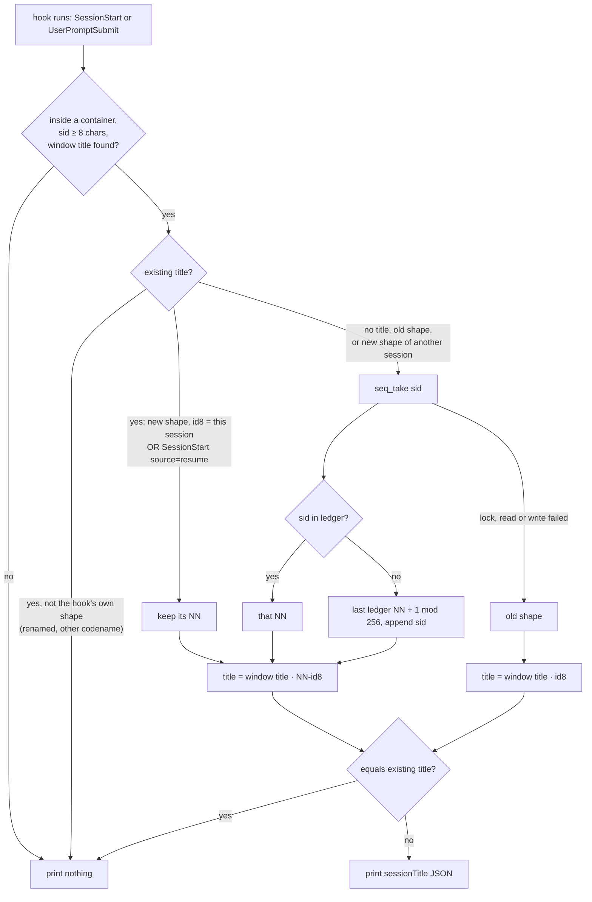

# Session title sequence number Implementation Plan

> **For agentic workers:** REQUIRED SUB-SKILL: Use superpowers:subagent-driven-development (recommended) or superpowers:executing-plans to implement this plan task-by-task. Steps use checkbox (`- [ ]`) syntax for tracking.

**Goal:** Title each Claude Code session in a codeo container `<window title> · <NN>-<id8>`, where `<NN>` is a per-container two-digit hex sequence number, so the newest session can be picked out by name.

**Architecture:** `.devcontainer/scripts/session-title.sh` keeps a ledger of `<NN> <session id>` lines in the clone's git directory (`$(git rev-parse --git-path codeo/session-seq)`), takes the next number under `flock`, and keeps a session's number from its existing title or from the ledger. When the counter cannot be used it prints the old shape. No new script, no new hook registration.

**Tech Stack:** bash 4.3+, jq, `flock` (util-linux, in the dev container image); `tests/devcontainer.test.sh` (`st_*` helpers, scratch repos, stdin fixtures).

**Spec:** issue #181 (`.codeo/intake/181/body.md`) and `.codeo/181/plan.md` Q1-Q5 (all answered with the recommendation). No separate reference doc: nothing here is a standing decision beyond the hook's header comment.

## Global Constraints

- Title shape: `<window title> · <NN>-<id8>`; `<NN>` is two **uppercase** hex digits (`00`-`FF`); `<id8>` is the first eight characters of the session id. After `FF` the next number is `00`; a fresh clone starts at `00`.
- Counter kept per container in the clone's git directory (Q1): `codeo-home` and each `codeo-<N>` count separately, it survives a restart, it never appears in `git status`.
- A number is spent at most once per session id (Q2: existing title first, then the ledger). A `/rename`d title spends none. Fresh start, `/clear` and fork take the next number; a resume keeps its own; a lock change keeps `<NN>` and changes only the window-title part.
- Counter failure (Q3): print the old shape `<window title> · <id8>`; nothing when the session already has exactly that title.
- The hook keeps its contract: nothing printed outside a dev container, cmd-mode container or sbx sandbox; stderr empty and exit status 0 on every path; it fits the 10-second hook timeout (lock wait is 2 seconds).
- Invariants document: none configured. Shared environment: none, so no task carries a lease marker. Suite: `shell` (`bash tests/run.sh`, no `filter`), so a code task's proof is the whole suite.
- Documentation: moves `.devcontainer/README.md` (the title table row and the "session title" bullet) and `CHANGELOG.md` (a new `## Unreleased` section, Q5). `docs/container-templates.md` lists `session-title.sh` only as a file copied as it is, so it does not move.
- Footprint overlap with #217 (`CHANGELOG.md`, `.devcontainer/README.md`): proceed and coordinate (Q4). Edit only the lines this plan names, so the merge conflict, if any, is a list-position one.

## Review Focus

1. Two sessions starting at once (a VS Code window reopening several sessions): numbers must differ. Task 2 pins it with eight parallel runs.
2. A run with no `session_title` for a session the hook already numbered (a transcript-less `/clear` flow, a restart): the same number comes back, none is spent. Task 1 pins it with the ledger.
3. A state file that is unreadable, unwritable or garbage: old shape, empty stderr, exit 0. Task 2 pins it.
4. A forked session's inherited `NN-id8` title with another id: takes a new number, does not keep the parent's. Task 1 pins it.
5. A title that merely looks like the new shape (lowercase `1a`, one digit, seven-character id, another codename): treated as renamed and left alone. Task 1 pins it.

## How the number is chosen



My call, not in the issue: a `source: resume` `SessionStart` keeps the number in the inherited title even when its `<id8>` differs from the session id, because a resume may hand the session a new id and the issue says a resume keeps its number. The ledger then records that id, so later prompts find it. If Claude Code resumes under the same id, the id8-match rule already covers it. Task 1 starts by checking the `source` values the hook receives (`startup`, `resume`, `fork`, `clear`) against Claude Code's hook documentation; if `resume` behaves differently, the resume test and this rule change before any code does.

## File Structure

| File | Change |
|---|---|
| `.devcontainer/scripts/session-title.sh` | counter, ledger, new recognition, header comment |
| `tests/devcontainer.test.sh` | existing `session_title_*` expectations move to the new shape; new tests; the test list at the end of the file |
| `.devcontainer/README.md` | title table row and the session-title bullet |
| `CHANGELOG.md` | `## Unreleased` with one bullet |
| `docs/plans/2026-11-28-session-title-sequence-181.md` | this plan |

---

### Task 1: The number, the new shape and the recognition rules

**Files:**
- Modify: `.devcontainer/scripts/session-title.sh`
- Test: `tests/devcontainer.test.sh`

**Interfaces:**
- Produces, inside `session-title.sh`: `seq_file` (prints the absolute state path, `$(git -C "$here" rev-parse --path-format=absolute --git-path codeo/session-seq)`, rc 1 when it cannot); `seq_take <sid> [<nn>]` (prints `<NN>`, rc 1 on any failure; with `<nn>` it records `<nn> <sid>` unless the sid is already in the ledger and prints the ledger's number; without it, prints the ledger's number for the sid, else the next one after the last ledger line's, wrapping `FF` to `00`, and appends it). Ledger line: `<NN> <session id>`, `NN` matching `[0-9A-F]{2}`; lines that do not match are ignored; only the last 256 lines are kept. The file is rewritten through a temp file and `mv`.
- Produces: the hook reads a fourth field, `source`, from the input JSON (empty when absent).
- Task 2 wraps `seq_take`'s read-modify-write in `flock`.

- [ ] **Step 1: Check the hook inputs.** Read Claude Code's hooks documentation for `SessionStart`'s `source` values and whether a resumed session keeps its `session_id`. Write the finding in one line under `## Notes` of `.codeo/181/implement.md` when that file exists, or in the commit body. If `resume` keeps the id, keep the `source=resume` rule anyway (harmless); if the documentation contradicts the flow chart above, stop and raise it to the engineer.

- [ ] **Step 2: Move the existing tests to the new shape, and write the new ones (failing).** In `tests/devcontainer.test.sh`:
  - Every expected `'codeo [home] · a21b9973'` becomes `'codeo [home] · 00-a21b9973'`, and `'codeo [#47] · a21b9973'` becomes `'codeo [#47] · 00-a21b9973'`, in `session_title_names_home_and_the_id`, `…names_the_issue_with_a_lock`, `…cmd_mode_titles_home_and_the_issue`, `…in_a_sandbox_names_the_issue`, `…on_a_prompt_after_clear`, `…hook_command_survives_a_missing_script` and the other `session_title_*` tests that assert a title. Find them with `grep -n "a21b9973" tests/devcontainer.test.sh`.
  - Add `st_seq_file`: `printf '%s' "$st_dir/.git/codeo/session-seq"`.
  - `session_title_numbers_sessions_in_order`: three `SessionStart` runs with sids `a21b9973-…`, `b3…`, `c4…` (eight hex characters each) and no title → titles `… · 00-a21b9973`, `… · 01-b3…`, `… · 02-c4…`.
  - `session_title_keeps_a_sessions_number`: run `a21b9973`, then `b3…`, then `UserPromptSubmit` for `a21b9973` with no `session_title` → `00-a21b9973` again, and `$(grep -c . "$(st_seq_file)")` is `2`.
  - `session_title_clear_and_fork_take_the_next_number`: sid A titled (00); `UserPromptSubmit` for a new sid B with no title → `01-<B8>`; a `SessionStart` with `source: "fork"`, sid C and `session_title` `codeo [home] · 00-<A8>` → `02-<C8>`.
  - `session_title_resume_keeps_its_number`: sid A titled `00-<A8>`, sid B started (01); a `SessionStart` with `source: "resume"`, sid A and title `codeo [home] · 00-<A8>` → silent; the same with a different sid D and that title → `00-<D8>` and a later `UserPromptSubmit` for D with no title → `00-<D8>` (needs `st_json` to take an optional `source`: add a fourth argument that replaces the default `"startup"`).
  - `session_title_wraps_after_ff`: write `FE aaaaaaaa-…` and `FF bbbbbbbb-…` into the state file, then a new sid → `00-<id8>`.
  - `session_title_counts_per_clone`: two `st_setup` clones; each titles its first session `00`, and a second session in the first is `01` while the second clone's next is still `01`.
  - `session_title_lock_change_keeps_the_number`: `codeo [home] · 1A-a21b9973` with a lock on issue 47 → `codeo [#47] · 1A-a21b9973`; and back.
  - `session_title_moves_an_old_shape_title`: title `codeo [home] · a21b9973` → `codeo [home] · 00-a21b9973` (takes the next number); a title `codeo [home] · ffffffff` of another session also moves.
  - Extend `session_title_keeps_a_renamed_title` with silent cases: `codeo [home] · 1a-a21b9973` (lowercase), `codeo [home] · 1-a21b9973`, `codeo [home] · 1A-a21b997`, `codeo [home] · 1A-A21B9973`, and `x [home] · 1A-a21b9973`; and assert the state file does not exist after the run (a renamed session spends no number).
  - Add each new function to the list at the end of the file, beside the other `session_title_*` calls.

- [ ] **Step 3: Run the suite to see it fail.** Run: `bash tests/run.sh`. Expected: non-zero exit, with the new and moved `session_title_*` tests failing (titles lack `NN-`).

- [ ] **Step 4: Implement.** In `.devcontainer/scripts/session-title.sh`: read `source` as a fourth NUL-separated field; replace the id8-only regex with `^(.+) \[(home|#[0-9]+)\] · (([0-9A-F]{2})-)?([0-9a-f]{8})$` (one line, same codename as `base`); decide the number as in the flow chart (ownership check first, so a renamed title returns before any number is taken); build `title="$base · $nn-${sid:0:8}"`; add `seq_file` and `seq_take`, each silent on stderr and returning 1 on any failure. The `source == resume` rule applies only when the existing title is in the new shape.

- [ ] **Step 5: Update the header comment** of `session-title.sh` (the `containers.test.sh` leak scan allows `codeo [home]` there only on `#` lines): the title shape, the ledger, the three rules (own title, ledger, next number), the fallback, "nothing is read or written for a renamed session".

- [ ] **Step 6: Run the suite.** Run: `bash tests/run.sh`. Expected: exit 0.

- [ ] **Step 7: Commit.**

```bash
git add .devcontainer/scripts/session-title.sh tests/devcontainer.test.sh
git commit -m "feat: number each session title per container (#181)"
```

**Proof of done:** `bash tests/run.sh` exits 0 with the Task 1 tests among those that pass.

---

### Task 2: Concurrent starts and counter failure

**Files:**
- Modify: `.devcontainer/scripts/session-title.sh`
- Test: `tests/devcontainer.test.sh`

**Interfaces:**
- Consumes: `seq_file`, `seq_take` from Task 1.
- Produces: `seq_take` now holds `flock -w 2` on `<state file>.lock` (opened on fd 9; the lock file is created beside the state file) around the read, the append, the trim and the `mv`; a `flock` that is missing or times out is a failure (rc 1).

- [ ] **Step 1: Write the failing tests.**
  - `session_title_concurrent_starts_get_different_numbers`: spawn eight background runs of the hook (`bash "$st_dir/.devcontainer/scripts/session-title.sh"` with the same environment `st_run` builds, each fed a `SessionStart` fixture with its own sid, output to its own file under `$pl_root`), `wait`, then assert the eight titles' `<NN>` are unique and are exactly `00`-`07`, and every stderr file is empty. Factor the environment `st_run` builds into a helper both use.
  - `session_title_falls_back_to_the_old_shape`: make the state path a directory (`mkdir -p "$(st_seq_file)"`) → title `codeo [home] · a21b9973`, `st_err` empty, `st_rc` 0; with `session_title` already `codeo [home] · a21b9973` → silent; with `session_title` `codeo [home] · 00-a21b9973` (its own number) → the number is kept, not downgraded.
  - `session_title_fallback_survives_a_missing_flock`: put a `PATH` containing `jq`, `git`, `bash` and the other tools the hook uses but no `flock` (a scratch bin directory of symlinks), run the hook → old shape, `st_err` empty, `st_rc` 0. Skip with a `SKIP` line when a tool cannot be linked.
  - `session_title_ignores_a_garbage_ledger`: a state file holding `hello`, a blank line and `ZZ x` → the first session is `00`.
  - `session_title_trims_the_ledger`: seed 300 lines `00 <sid>` cycling numbers, run one session → the file has 256 lines and the title is the number after the last seeded line.
  - Add them to the list at the end of the file.

- [ ] **Step 2: Run to see them fail.** Run: `bash tests/run.sh`. Expected: non-zero exit; the concurrent test fails on duplicate numbers (the fallback tests may already pass from Task 1, which is fine).

- [ ] **Step 3: Implement the lock** in `seq_take` as described under Interfaces. A failure anywhere in `seq_take` leaves the old state file as it was (the temp file is removed). The hook's caller prints the old shape on rc 1.

- [ ] **Step 4: Run the suite.** Run: `bash tests/run.sh`. Expected: exit 0. Run it three times in a row and expect exit 0 each time, since the concurrency test is the one that can flake.

- [ ] **Step 5: Commit.**

```bash
git add .devcontainer/scripts/session-title.sh tests/devcontainer.test.sh
git commit -m "feat: take the session number under a lock and fall back to the old title (#181)"
```

**Proof of done:** `bash tests/run.sh` exits 0, three times running.

---

### Task 3: Documentation

**Files:**
- Modify: `.devcontainer/README.md`
- Modify: `CHANGELOG.md`
- Test: `tests/readme.test.sh` runs inside the suite

**Interfaces:** none.

- [ ] **Step 1: `.devcontainer/README.md`.** In the table's title row, leave the window title as is (it is the VS Code window, out of scope). Rewrite the bullet "The session title is set by the same hook as in VS Code." into a short paragraph that says: the session is titled `<window title> · <NN>-<id8>`, for example `codeo [home] · 1A-2cb71525`; `<NN>` is a two-digit hex count per container that goes up by one for each new session id (a fresh start, `/clear`, a fork), a resume keeps its number, after `FF` it is `00`, it lives in the clone's git directory (`codeo/session-seq`, so it survives a restart, restarts at `00` in a fresh clone and is not shared between `codeo-home` and `codeo-<N>`); a `/rename`d title is left alone; an old `<window title> · <id8>` title is moved to the new shape; when the counter cannot be used the title is the old shape. Keep the edit to those lines.

- [ ] **Step 2: `CHANGELOG.md`.** Add above `## v1.0.11` a `## Unreleased` section in the same form as the release sections: `Config schema: 1 (unchanged)`, `Shared state: none` (the counter is a file in the clone's git directory, not shared), `Safe to bump mid-workflow: yes`, and one bullet describing the new title shape, the rules above in two or three sentences, and `(#181)`. `docs/release-checklist.md` retitles the section at release time; do not touch it.

- [ ] **Step 3: Run the suite.** Run: `bash tests/run.sh`. Expected: exit 0 (`tests/readme.test.sh` and the changelog-shaped checks pass with the new text).

- [ ] **Step 4: Commit.**

```bash
git add .devcontainer/README.md CHANGELOG.md
git commit -m "docs: describe the numbered session title (#181)"
```

**Proof of done:** `bash tests/run.sh` exits 0; `grep -c '<NN>-<id8>' .devcontainer/README.md CHANGELOG.md` prints a count of at least 1 for each file.

---

## Self-review

- **Criteria → tasks.** New session `NN`, next `NN+1`: Task 1 (`numbers_sessions_in_order`). `/clear`, fork, resume: Task 1. Wrap after `FF`: Task 1. Restart and per-container counts: Task 1 (`counts_per_clone`; the state file is on disk, every run is a new process). Lock change keeps `NN`: Task 1. Rename left alone, old shape moved: Task 1. Concurrent starts: Task 2. `CHANGELOG.md`, `.devcontainer/README.md` and the suite: Task 3 and every task's proof.
- **Names.** `seq_file`, `seq_take` and `st_seq_file` are used with the same spelling in all three tasks.
- **Open assumption.** Task 1 step 1 verifies the `source` values and resume's id behaviour before the code depends on it.

### Footprint

```
files:      .devcontainer/scripts/session-title.sh, tests/devcontainer.test.sh, .devcontainer/README.md, CHANGELOG.md, docs/plans/2026-11-28-session-title-sequence-181.md
wiki:       none
exclusive:  none
sequenced:  none
```
