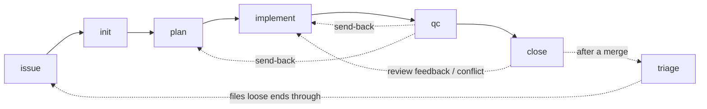

# Skills

This page describes each codeo skill: what it is for and when it triggers, what it reads and writes, where it hands off and what it refuses to do, and which extension points it registers. The sections follow the order a workflow meets the skills in, then the two that set a project up.

Six skills form the pipeline: `issue`, `init`, `plan`, `implement`, `qc` and `close`. They run in that order inside one workflow, and the workflow is bound to one issue by the lock (`.codeo/active`, written by `init` and released by `close`). Each skill hands the next one a dossier file, `.codeo/<N>/<skill>.md`, under the protocol in `docs/handoff.md`. `qc` can send a change back to `implement` or `plan`, and `close` can send review feedback or a conflict with the base branch back to `implement`. `issue` runs before an issue number or a branch exists, so it sits outside the lock.

`triage` runs outside the lock too, between workflows: it collects the loose ends development left behind and routes anything worth filing through `issue`. `setup` and `doctor` are not part of any workflow: `setup` creates the project's codeo state and `doctor` checks that the project is ready.

## issue

### Purpose and triggers

Turns a raw idea, bug report, or out-of-scope finding into a well-formed GitHub issue (problem statement, requirements, and acceptance criteria) through a question-and-answer pass with the engineer, then files it with `gh api`, Issue Type included. It triggers on "file an issue", "draft an issue for X", "turn this into an issue", "write up a bug report", or when `/codeo:plan`, `/codeo:implement` or `/codeo:triage` hits work that belongs in an issue of its own.

The skill drafts and files the issue and does nothing else. It captures the what and why (problem, requirements, acceptance criteria), not the how: contracts, diagrams and design belong to `/codeo:plan`. It is standalone: it files the issue, reports the number, and stops. When another skill calls it, that skill passes the finding and the context it already has but does not answer the questions on the engineer's behalf, and filing returns control to the caller with the new issue's number.

### Reads and writes

- Reads existing issues, the relevant code, and whatever context a calling skill passes.
- Writes the GitHub issue, and `.codeo/intake/<N>/issue.md`, drafted under `new-<slug>/` and renamed once the number exists. The dossier is committed only to the intake branch, through `scripts/intake.sh`, which never checks that branch out. Nothing goes on the default branch or on a feature branch: no branch is cut and no commit is made where a PR could pick it up.

### Hand-offs and non-goals

- Hands off to nobody: it sits outside the workflow's lifecycle, before an issue number or a branch exists. It still ends with the closing block, whose next goal is starting the issue with `/codeo:init #<N>`.
- Never touches the project's docs, code, the branch, the lock, or another skill's dossier file. When another skill calls it, that caller records the new number in its own outcome and log line.
- Does not design a solution, request/response contract, or architecture diagram; that is `/codeo:plan`'s purview.
- Does not write code or plan docs.
- Does not commit to the default branch or to whatever branch is checked out; its dossier goes only to the intake branch.
- Does not cut a branch, open a dossier on a feature branch, or hand off to another skill; `/codeo:init` is a separate step the engineer runs when ready.

### Extension points

None.

## init

### Purpose and triggers

Starts work on an already-filed GitHub issue. It validates and claims the number, gates on the project board's Ready status when a board is configured and moves the card to in progress, cuts and pushes the branch off the updated base branch with its dossier, takes the workflow lock, and hands off to `/codeo:plan` in the same session, unless the project's host workflow says where the later steps run. It triggers on "start issue #N", "init #N", "let's work on issue N", or once `/codeo:triage` has marked a newly filed issue Ready.

The skill turns a filed issue into a place to work: a pushed branch carrying a dossier, a checkout bound to it, and a dossier handed to `/codeo:plan`. It also starts the workflow: the checkout the issue's later steps run in takes `.codeo/active` from what this skill pushed, every skill after it reads that lock to learn which issue it is bound to, and it stays bound until `/codeo:close`. The create-only push is the claim: of two `init` runs on one issue exactly one push succeeds, and every check before it is advisory.

### Reads and writes

- Reads the GitHub issue, its board Status (`board.sh status`, when a board is configured), `.codeo/intake/<N>/issue.md` when there is one, the list of workflows already under way from `inflight.sh`, and the project's `init/host-workflow` overlay section when there is one.
- Writes the branch, pushed create-only through `claim.sh`, which is the claim; on a resume, one `resumed:` log line in `init.md`, pushed against the tip it saw.
- Writes the issue's assignee, and its board Status from Ready to in progress through `board.sh`, when a board is configured.
- Writes `.codeo/<N>/init.md`, the adopted `.codeo/<N>/issue.md` and, when it is the first to need it, `.codeo/.gitignore`, all committed onto the branch.
- Writes the lock: by default `lock.sh take local` writes it in this checkout from the pushed `init.md`; with a host workflow, wherever that workflow says.

### Hand-offs and non-goals

- Hands off to `/codeo:plan`, naming `.codeo/<N>/init.md` as the thing to read first, and only once nothing in that file is still open. It tells `plan` to read the dossier rather than re-fetch the issue or re-ask the engineer what it already answers.
- Never touches the issue's text, the project's docs or wiki, any code, or another skill's dossier file.
- Does not draft, refine, or re-scope the issue's content; that is `/codeo:issue`'s purview.
- Does not design anything or write a plan doc; that is `/codeo:plan`'s purview.
- Does not write code, documentation, or open a PR. It commits and pushes only the dossier, and only onto the branch it just created or is resuming.
- Does not touch the project's wiki.
- Does not release the lock it takes, and does not stash or close someone else's: a workflow already running on this issue stops this skill rather than being overwritten by it.
- Does not switch branches before the push; the branch exists only in a scratch worktree until it is on origin.

### Extension points

- `init/host-workflow` — None; the skill hands off to plan in the same session. ([detail](extension-points.md#inithost-workflow))

## plan

### Purpose and triggers

Brainstorms, architects, and documents a feature or change before any code is written. It explores existing conventions, asks clarifying questions in the dossier, produces Mermaid diagrams, checks the change's footprint against every other workflow in flight, and saves a reference doc or implementation plan under the project's docs or plans directory only after explicit review. It triggers on "plan out", "design", "architect", before starting non-trivial implementation work, or right after `/codeo:init` hands off.

The skill produces a reviewed planning artifact and never edits application code; that is the later step `/codeo:implement`, which hands the plan to `superpowers:executing-plans` or `superpowers:subagent-driven-development` once the output is approved. It is the pipeline's thinking step, so it runs on the strongest model available and draws on whatever `superpowers:*` skill fits the work, `brainstorming` and `writing-plans` being the two that always apply.

### Reads and writes

- Reads `.codeo/<N>/init.md` and `issue.md`, the pages under the docs directory (and the wiki pages, with the `wiki` module), the plans under the plans directory, the invariants document when one is configured, the codebase, the project's overlay sections for this skill, and every other in-flight workflow's footprint through `inflight.sh` and `overlap.sh`.
- Writes `<plansDir>/YYYY-MM-DD-<slug>.md` or `<docsDir>/<slug>.md`, and `.codeo/<N>/plan.md` (its questions, its `## Outcome`, and one `## Log` line per invocation), committed and pushed on every turn it writes it. The plan doc itself stays unstaged while it awaits the engineer's approval; the dossier does not.
- Writes the leases on the exclusive resources its footprint names, through `intake.sh lease`.

### Hand-offs and non-goals

- Hands off to `/codeo:implement`, naming the committed plan file, and only once nothing in `.codeo/<N>/plan.md` is still open.
- May call `/codeo:issue` for out-of-scope findings. This is a call, not a hand-off: control returns, and the skill records the number in its own outcome and log line.
- Never touches the issue's text, the documentation pages other than the reference doc it chose (it names them; `/codeo:implement` writes them), code, the branch, the lease on the shared environment, or another skill's dossier file. An intake question it resolves is recorded in its own `## Outcome`, never struck from `init.md`.
- Does not author a GitHub issue itself; that is `/codeo:issue`'s purview. It may delegate an out-of-scope finding back to that skill but never writes the issue's text.
- Does not write or edit application code, or run its own build/test/review loop; that is `/codeo:implement`'s purview once the doc is approved and committed.
- Only creates or modifies files under the plans and docs directories, besides its own dossier and the draft files beside it.

### Extension points

- `plan/plan-shape` — Use the generic plan shape in the skill. ([detail](extension-points.md#planplan-shape))
- `plan/proof-of-done` — The suite's filter with {} replaced by the name of the test the task writes; a suite without filter has no single-test form and its whole test command is the proof. With no suites configured, the task names its proof command in full. ([detail](extension-points.md#planproof-of-done))
- `plan/environment-lease-notes` — None; the plan adds no environment lease notes. ([detail](extension-points.md#planenvironment-lease-notes))
- `plan/wiki-rules` — Documentation rules are only the project's docsDir conventions. ([detail](extension-points.md#planwiki-rules))

## implement

### Purpose and triggers

Executes an approved, committed implementation plan task by task through the plan's own superpowers sub-skill, taking the project's shared environment lease when a task needs it, confirming the change builds, and handing off to `/codeo:qc` for grading. It triggers on "implement the plan", "let's build this", "start implementing <plan>", or right after a plan under the project's plans directory has been reviewed, approved and committed.

The skill executes an already-approved plan; it does not plan, draft issues, or decide architecture. If the plan looks wrong or stale once implementation starts, it stops and says so rather than silently deviating, and suggests re-running `/codeo:plan`. Work that surfaces mid-task but belongs to no task in the plan goes to `/codeo:issue` as its own issue.

### Reads and writes

- Reads the committed plan file, `.codeo/<N>/init.md` and `plan.md`, `qc.md` or `close.md` when sent back, the codebase, the pages under the docs directory (and the wiki pages, with the `wiki` module) that the plan's documentation tasks name, the project's overlay sections for this skill, and every other in-flight workflow's footprint through `inflight.sh` and `overlap.sh`.
- Takes the lease on the shared environment resource, when one is configured, at the first task that needs it, and records a wait when another issue holds it or has the turn, through `intake.sh lease` only. It takes it again before any round's hand-off when the change since the last deployed revision alters what the environment runs. It never releases it; that is `/codeo:qc`'s, at its clear verdict.
- Writes application and test code, the documentation pages the plan names, and `.codeo/<N>/implement.md` (its questions, its `## Outcome`, and one `## Log` line per invocation), committed and pushed on every turn it writes it.

### Hand-offs and non-goals

- Hands off to `/codeo:qc`, naming the branch and the plan it worked from, and only once nothing in `.codeo/<N>/implement.md` is still open. It may be sent back with findings; that opens a new round in the same file, never an edit to an answered one.
- May call `/codeo:issue` for out-of-scope findings. This is a call, not a hand-off: control returns, and the skill records the number in its own outcome and log line.
- Never touches the plan's text, the issue's text, a documentation page the plan does not name, or another skill's dossier file. A plan that is wrong gets reported, not edited.
- Does not author an issue itself, though it delegates out-of-scope findings to `/codeo:issue` rather than absorbing them into the change.
- Does not design or write a plan; that is `/codeo:plan`'s.
- Does not invent its own task-execution loop: it delegates to the `superpowers:*` sub-skill the plan names, which owns task dispatch, checkbox tracking and per-task review.
- Does not grade its own work: the full test suites, the acceptance criteria, the invariants and the code review are `/codeo:qc`'s purview.
- Only touches the code the plan's File Structure names and the documentation pages its tasks name, plus optionally committing the plan file itself; it never edits the plan's content.

### Extension points

- `implement/environment-lease-notes` — None; the lease and deploy paragraphs are the whole rule. ([detail](extension-points.md#implementenvironment-lease-notes))
- `implement/wiki-rules` — Documentation rules are only the project's docsDir conventions. ([detail](extension-points.md#implementwiki-rules))

## qc

### Purpose and triggers

Quality-checks what `/codeo:implement` produced: the build, the configured test suites, the issue's acceptance criteria, the project's invariants, an independent code review and, when the project has a shared environment, what it actually runs. It then reports findings and routes the engineer forward to a pull request or back to `/codeo:implement` or `/codeo:plan`. It triggers on "qc", "quality check", "run the checks", or right after `/codeo:implement` finishes a plan.

The skill is the gate between building and merging. It never fixes what it finds: a skill that both judges and repairs would quietly lower its bar, and would be doing `/codeo:implement`'s job besides. Reporting and routing are the whole job. Findings are scoped to the diff under review; pre-existing debt the change happens to sit next to is not a finding.

### Reads and writes

- Reads the diff, the plan file, every other skill's dossier file, the pages under the docs directory (and the wiki pages, with the `wiki` module), the project's overlay sections for this skill, every other in-flight workflow's footprint through `inflight.sh` and `overlap.sh`, and the output of the suites it runs.
- Writes `.codeo/<N>/qc.md` (its questions, its `## Outcome` rounds with the `#### Environment` block when the project has a shared environment, and one `## Log` line per invocation), committed and pushed on every turn it writes it. Nothing else.
- Checks the lease on the shared environment resource, when one is configured, re-takes it only as its holder, and records no wait on it. It releases the lease at a clear verdict and only then, through `intake.sh lease release` when this issue holds it, with the script's output appended to the round.

### Hand-offs and non-goals

- Hands off to exactly one of three routes: forward to `/codeo:close`, back to `/codeo:implement`, or back to `/codeo:plan`, and only once nothing in `.codeo/<N>/qc.md` is still open. A send-back is still a hand-off: it names the findings and stops; it does not start the fixing.
- May call `/codeo:issue` for a real problem that is out of scope for the change. This is a call, not a hand-off: control returns, and the skill records the number in its own `## Outcome` and `## Log` line.
- Never touches code, tests, the plan's text, the issue's text, a documentation page, or another skill's dossier file. A test it wishes existed, or a page it wishes said something else, is a finding, not something to write.
- Does not fix anything it finds, not the code, a test, or a typo; that is `/codeo:implement`'s purview.
- Does not edit the plan or re-scope the work; that is `/codeo:plan`'s purview.
- Does not open, merge or approve a pull request; opening one on a clear verdict is `/codeo:close`'s. It pushes its own dossier commits and nothing else.
- Does not deploy, build for the environment, or take the lease to change what the environment runs; it reads what is deployed and sends back what is stale.
- Does not invent acceptance criteria. If `init.md` has none to judge against, that is itself the finding, and it routes back to whoever owed them.

### Extension points

- `qc/environment-evidence` — None; the evidence is the deployed hook's output and nothing more. ([detail](extension-points.md#qcenvironment-evidence))
- `qc/wiki-rules` — Documentation checks are only the project's docsDir conventions. ([detail](extension-points.md#qcwiki-rules))
- `qc/invariants-extra` — None; the reviewer works from the criteria, the invariants file and the diff. ([detail](extension-points.md#qcinvariants-extra))

## close

### Purpose and triggers

Ends a codeo workflow. It opens the pull request, waits for the engineer to merge it, routes review feedback or a conflict with the base branch back through `/codeo:implement` and `/codeo:qc`, releases the shared environment at approval when it is still held, then proves the merge, deletes the remote branch on the engineer's yes, and releases every lease and the lock. It is also the way to stash a workflow (park it, Ready to start again) and to abandon one whose pull request was closed unmerged (back to the backlog). It triggers on "close", "close the workflow", "open the PR", "it's merged", "clean up", "stash this", or right after `/codeo:qc` returns a clear verdict.

The skill is the pipeline's last step. The workflow ends at the merge, not when the pull request opens: until then review feedback still has somewhere to go. It never merges, approves or reviews; the merge is the engineer's. It runs in phases and works out which one from facts (the lock, where the dossier sits, and the pull request's state on GitHub), so running it again is safe at any time.

### Reads and writes

- Reads the lock, every dossier file (`qc.md`'s last round above all), and the pull request's state, reviews and checks on GitHub.
- Writes `.codeo/<N>/close.md` (its questions, its `## Outcome` rounds and one `## Log` line per invocation), the commits carrying it and the archive moves, the pull request and its comments, and the clean base-branch merge it makes when the branch is behind, its one commit that is not a dossier commit. Nothing else.
- Deletes `.codeo/active` and the merged branch on the remote (or, on an abandon, the unmerged one, only when the engineer asks), and moves the dossier directory in and out of `.codeo/done/`. It is the only skill that may do any of these.
- Releases every lease the issue holds at every exit (the merge, a stash, an abandon) and the environment at approval when it is still held. It takes the shared environment resource only for a put-back, when the issue no longer holds it, and releases it with the rest. It removes the issue's assignee on a stash or an abandon, after putting the environment back.
- Moves the issue's board card through `board.sh`, with a board: In review when the pull request opens or is readied again, In progress on a send-back, Ready on a stash, Backlog on an abandon, Done once the merge is verified. Each move is part of its step, never a gate on it.

### Hand-offs and non-goals

- Hands off to `/codeo:implement` when review asks for changes or the branch conflicts with the base branch (a send-back); otherwise to nobody. The workflow ends when the merged branch is cleaned up and the lock released.
- Never touches code, tests, documentation pages, the plan's text, the issue's text, another skill's dossier file, or the base branch.
- Does not merge, approve or review the pull request, and does not answer review comments on the implementer's behalf beyond a summary of what changed.
- Does not re-run the build, the suites or the acceptance criteria; that is `/codeo:qc`'s.
- Does not fix anything, whether a problem found on the way past or a review comment; those are send-backs.
- Does not delete a branch without GitHub's merged state, a tip that matches the pull request's head and the engineer's yes (on an abandon, the engineer must ask in so many words, after the same confirmation). It never deletes the base branch, force-pushes, or rewrites history.
- Does not commit to the base branch; its last commit is on the branch, before the merge.
- Does not start the next workflow; releasing the lock is the invitation, and `/codeo:init` is still the engineer's to run.
- Does not remove the checkout it runs in; it relays how, from the project's host workflow.
- Does not dispatch a workflow or make any write an overlay's text prints: what `close/ci-publish-check` and `close/host-workflow` print is relayed and reported, never executed.

### Extension points

- `close/put-back` — None; a stash or an abandon releases what is held and records what the environment carries. ([detail](extension-points.md#closeput-back))
- `close/ci-publish-check` — None; no check of what CI did for the merge commit. ([detail](extension-points.md#closeci-publish-check))
- `close/host-workflow` — None; the report names the lock's host and says whether anything is left to remove. ([detail](extension-points.md#closehost-workflow))

## triage

### Purpose and triggers

Finds the loose ends development left behind: non-blocking QC findings and implementation deviations nobody filed, stashed or abandoned workflows, branches with no PR, issue drafts never filed, issues never started, and unresolved review threads on merged PRs. It checks each against existing issues and asks the engineer what to do with each one. Anything worth filing goes through `/codeo:issue`, and a filed issue the engineer calls workable moves to Ready on the project board. It triggers on "triage", "what did we forget", "any loose ends", "anything we should file", or after `/codeo:close` finishes a merge.

Every step of the pipeline notices things that are real but not its job, and nothing downstream picks those up once a dossier is archived. The skill gathers them and asks the engineer, item by item. It decides nothing and changes nothing but its own ledger and, on the engineer's answer, the board. It is what makes an issue startable: `/codeo:init` starts only an issue whose Status on the project board is Ready (when a board is configured), and this skill is where the engineer says an issue is. Like `/codeo:issue`, it runs outside the workflow lock. It takes optional flags: `--docs` also scans Not-built lists in the project's docs and wiki, `--todos` scans TODO/FIXME comments, and `--all` does both.

### Reads and writes

- Reads anything: every branch's dossiers, the intake branch, issues, pull requests and their review threads, and, with the flags, the project's docs, its wiki pages and the code.
- Writes `.codeo/intake/triage/` (the ledger and the run files), committed to `codeo/intake` through `intake.sh`, never to the checked-out branch.
- Writes an issue's board Status, to Ready or Backlog only, only through `board.sh`, and only on the engineer's answer of mark Ready, resume or leave in the backlog.

### Hand-offs and non-goals

- Hands off to nobody: what to resume, and when, is the engineer's. It ends with the closing block naming the next issue to start.
- Calls `/codeo:issue` for every item the engineer chooses to file, and records the number it returns.
- Never touches the issues themselves, any other board Status, any branch, the lock, the project's docs or wiki, code, or any other skill's dossier, including the archived ones it reads.
- Does not file, edit, label or close issues; `/codeo:issue` files and the rest is the engineer's. Its board writes are Ready and Backlog only: In progress is `/codeo:init`'s, and In review and Done are `/codeo:close`'s.
- Does not resume, stash, rebase or delete a branch, and does not open or close a PR; it names the command.
- Does not fix anything it finds, however small.
- Does not re-judge a finding `/codeo:qc` already classified; it asks whether the finding still deserves an issue, not whether it was right.
- Does not decide what is noise; it ranks and says why something might not matter, and the engineer dismisses.

### Extension points

- `triage/todo-excludes` — Scan tracked files only, with no exclusions. ([detail](extension-points.md#triagetodo-excludes))

## setup

### Purpose and triggers

Sets up codeo in a project. It runs `scripts/setup.sh` from the project root, which creates `.codeo/` (with a `.gitignore` for the per-checkout files), a starter `config.json`, and `docs/plans/`. It triggers on "set up codeo", "setup codeo", "initialise codeo", "install codeo in this repo".

The script reads the repository owner and name from the `origin` remote and the base branch from `origin/HEAD`; when one does not resolve, the value is the marker `TODO-set-me` and a line on stderr says so, so a guessed value never passes for a real one. It refuses, exiting non-zero, when `.codeo/config.json` already exists. Any `--stack <name>` the engineer gives is passed through and recorded under the top-level `stacks` array, and does nothing else.

### Reads and writes

- Reads the `origin` remote and `origin/HEAD` of the project's git repository.
- Creates `.codeo/`, `.codeo/.gitignore`, a starter `.codeo/config.json`, and `docs/plans/`. It never overwrites an existing `config.json`.

### Hand-offs and non-goals

- Hands off to nobody. The skill reports the script's output verbatim, then ends with the closing block and adds nothing else; if the script exits non-zero, it says so and stops.

### Extension points

None.

## doctor

### Purpose and triggers

Checks that codeo is ready in a project: config, GitHub login and scopes, board, branch ruleset, suite commands and dependencies, reporting every failure. It runs `scripts/doctor.sh` from the project root. It triggers on "check codeo", "codeo doctor", "doctor", "is codeo set up", "why does codeo fail".

The script runs eleven checks: config, schema, codename, gh-auth, gh-scopes, board, ruleset, suites, deps, overlays and superpowers. It prints one `ok` or `fail` line per check, runs every check even after a failure, and exits non-zero if any failed. The ruleset check reads the effective rules for the base branch and compares the required status checks with `ci.requiredChecks`.

### Reads and writes

- Reads `.codeo/config.json` and the project's overlays, and reads GitHub through `gh api` (the board check's `gh project view` is the one exception, being GraphQL-backed).
- Writes nothing but its report.

### Hand-offs and non-goals

- Hands off to nobody. The skill reports the script's output verbatim, then ends with the closing block and adds nothing else; if the script exits non-zero, it says so and stops.

### Extension points

None.
